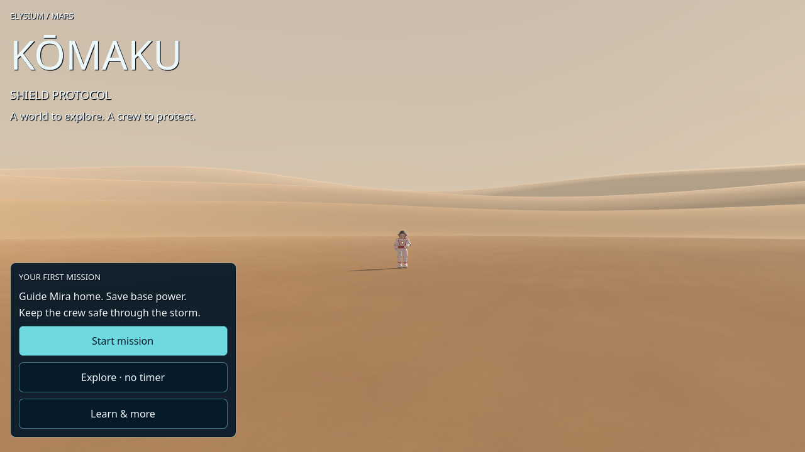

# <!-- brand:display_name -->KŌMAKU: Shield Protocol<!-- /brand -->

**Become the astronaut. Protect your crew.**

A first-person Mars learning game for ages 7–12. Work inside mission control, look out across the dunes, and make the energy decisions that help bring your crewmate Mira home.

[](https://github.com/roshaninfordham/NASA-SPACE-APPS-HACKATHON-2026/actions/workflows/validate.yml)

**Status: published playable alpha — 0.7.0-alpha.1.** Start inside mission control, looking through a clear window at dunes and stranded Mira. Three controls manage cleaning, base power and her return. The default forward view contains only dunes and Mira; the original outpost and outdoor EVA remain an advanced option. Source tests and native Linux input/capture checks pass. The published archives passed native hosted Mac/Windows launch gates; physical-device performance and learner testing remain open.



[Current screenshots and historical media](docs/MEDIA.md) · [Download the 16-page science guide](https://github.com/roshaninfordham/NASA-SPACE-APPS-HACKATHON-2026/releases/download/v0.7.0-alpha.1/KOMAKU-Shield-Protocol-0.7.0-alpha.1-Science-Guide.pdf)

**Latest release: [v0.7.0-alpha.1](https://github.com/roshaninfordham/NASA-SPACE-APPS-HACKATHON-2026/releases/tag/v0.7.0-alpha.1).** Published from `8968859e8ffdcda7b8c0c216ff0262df633400e6` with ten assets. [Release evidence](docs/evidence/release-0.7.0-alpha.1.json).

## Play on your laptop

Get the game from [GitHub Releases](https://github.com/roshaninfordham/NASA-SPACE-APPS-HACKATHON-2026/releases). Release notes identify available downloads, exact source commit, and what was tested. Game installers belong in Releases; an empty GitHub Packages tab does not mean downloads are missing.

The release provides macOS universal, Windows x64, Linux x64 and Web archives, with licenses and SHA-256 checksums. Each ZIP includes `START-HERE.txt` and `KOMAKU-Science-Guide.pdf`. Four ZIPs, the standalone PDF and five update/manifest/checksum files make ten assets.

The Mac universal binary includes arm64 for Apple Silicon, including M5, and x86_64 for Intel. It is ad-hoc signed for bundle integrity, without Apple Developer ID or notarization. Windows remains unsigned. Hosted native Mac/Windows launch checks passed; physical-device performance, audio and complete playthroughs remain separate tests. Native Android and iOS installers are not yet provided.

**Current download: [v0.7.0-alpha.1](https://github.com/roshaninfordham/NASA-SPACE-APPS-HACKATHON-2026/releases/tag/v0.7.0-alpha.1).** If an old 0.6.0 Mac app cannot open, install this full corrected download once; 0.7 retains the bundle-signing repair introduced in 0.6.1.

| Platform or document                   | Download                                                                                                                                                                           |
| -------------------------------------- | ---------------------------------------------------------------------------------------------------------------------------------------------------------------------------------- |
| MacBook M5 / Apple Silicon / Intel Mac | [macOS universal ZIP](https://github.com/roshaninfordham/NASA-SPACE-APPS-HACKATHON-2026/releases/download/v0.7.0-alpha.1/KOMAKU-Shield-Protocol-0.7.0-alpha.1-macOS-universal.zip) |
| Windows x64                            | [Windows ZIP](https://github.com/roshaninfordham/NASA-SPACE-APPS-HACKATHON-2026/releases/download/v0.7.0-alpha.1/KOMAKU-Shield-Protocol-0.7.0-alpha.1-Windows-x64.zip)             |
| Linux x64                              | [Linux ZIP](https://github.com/roshaninfordham/NASA-SPACE-APPS-HACKATHON-2026/releases/download/v0.7.0-alpha.1/KOMAKU-Shield-Protocol-0.7.0-alpha.1-Linux-x64.zip)                 |
| WebGL2 browser                         | [Web ZIP](https://github.com/roshaninfordham/NASA-SPACE-APPS-HACKATHON-2026/releases/download/v0.7.0-alpha.1/KOMAKU-Shield-Protocol-0.7.0-alpha.1-Web.zip)                         |
| 16-page science guide                  | [Standalone PDF](https://github.com/roshaninfordham/NASA-SPACE-APPS-HACKATHON-2026/releases/download/v0.7.0-alpha.1/KOMAKU-Shield-Protocol-0.7.0-alpha.1-Science-Guide.pdf)        |

See [download instructions](docs/DOWNLOADS.md). No development tools are required to play the native app. If macOS blocks the trusted download, the ZIP includes a one-time installer helper that asks for consent, verifies the app, preserves an existing copy, and removes quarantine only from the installed copy. It does not establish publisher identity or disable system-wide Gatekeeper. [Mac repair evidence](docs/MACOS-LAUNCH-REPAIR.md).

## In-game updates

The **desktop app checks for updates on every fresh launch** (since 0.6.1), once per process; a manual check is also available. Compatible signed content follows **Update available → Install → Restart**, with verification and recovery. Notices wait for safe menu/debrief points. There are no background notifications while the game is closed. An older Mac app that cannot start needs the corrected installer once; content cannot repair its native bundle. Installers from before 0.4 also need a manual upgrade. Engine/runtime changes require a full installer. [Behavior, evidence and limits](docs/UPDATES.md).

Browser offline/update packaging and the GitHub Pages deployment workflow are available in the repository. Public hosting is deferred by owner choice after verification found an inherited custom-domain redirect to another site; use downloadable builds for now. An internal Android build route is documented; no production Android/iOS native download or mobile self-updater is published.

## Your indoor mission

You are the operator inside mission control. Mira is outside, visible through the clear window. Move and look around within the room, manage the base power, and guide her back. The suit battery and dose readings belong to **Mira**; moving your own character indoors does not protect her.

- Use **1** or the cleaner button to toggle panel cleaning.
- Use **2** or the save button to reduce nonessential base power.
- Use **3 / Guide Mira** to begin her continuous route to the side airlock.
- Watch the return and airlock-cycle states. Mira gains shelter protection only after the cycle and her final walk inside are complete.
- Continue managing base power through the full **12 simulated hours**, including after Mira is safe.

**Tab** pauses for clickable controls; **Escape** returns to walking. **WASD** and the mouse move/look within the room. The handheld scanner is hidden in this mode. The scripted route and abstract airlock timing are teaching mechanics, not a validated crew-motion or pressure model. Source tests verify a successful full-duration rescue policy, the failure case when no action is taken, pause behavior and protection only after entry. Native release-archive launch checks passed; physical-device playtesting remains separate.

The original outdoor mission remains under **Learn & more → Outdoor EVA mission**. That advanced mode restores the outpost equipment, exterior exploration, array inspection, personal visor cleaning and the walk-in refuge. It is also the mission in the published 0.6.1 download. **E** interacts, **Q** cleans the visor and **Space** hops in that mode. Controller and landscape touch controls require further physical-device testing.

## Learn with Mira

Mira's Field Academy adds five short science lessons, ten questions, hints and explanations, and a local review plan. It is accessible from the title menu (under **Learn & more** in 0.7) and mission debrief. These lessons have been included since alpha 0.3.0-alpha.1. The tutor uses provisional Bayesian estimates, not a trained AI model; [learning design](docs/LEARNING-DESIGN.md) documents the research and limits. The [request tracker](docs/REQUEST-TRACKER.md) distinguishes delivered features from open requirements.

## More to explore in 0.7

Start with **Start mission** for the indoor rescue, **Explore · no timer** for an untimed room visit, or **Learn & more** for optional activities and outdoor EVA. The primary view keeps one priority objective, separate base/Mira battery gauges and three actions visible. The window frames the dunes and Mira; the room uses quieter pearl/navy materials and restrained cyan indicators.

The optional **AEGIS mission planner** opens with **P** or from Pause. It compares four cleaner/power-saving policies using private copies of the same mission model over one simulated hour, holding Mira’s current protection state fixed. It does not predict her travel or airlock timing. The game stays paused, and **Use this plan** changes only those switches. It is a transparent comparison tool, not trained AI or a live forecast. [Planner assumptions](docs/MISSION-PLANNER.md).

**Explorer Suit Lab**, **Habitat Field Notes**, Mira's academy and the field guide remain available through **Learn & more**. **I** opens habitat notes during untimed exploration. These activities pause the mission without changing its physical model. An untimed room tour can start a fresh rescue from Pause; it resets the clock, switches and Mira’s waiting state. The earlier, denser 0.6 artwork is documented in the [historical gallery](docs/MEDIA.md), while [design specifications](docs/design-specs/README.md) preserve the original references.

The [illustrated science guide](docs/media/KOMAKU-Science-Guide.pdf) has 16 pages of explanations, equations, units, worked examples and source/assumption boundaries. Its build checks detect stale model-source fingerprints.

The new landscape alone uses **21,388 retained triangles**, down from **109,710** in the prior optimized landscape. This is a geometry-workload comparison, not whole-game FPS, RAM or physical-device validation. Earlier 33.7%/approximately 61% figures describe pre-pivot work and do not measure the final 0.7 release. [Scope and evidence](docs/DESIGN-PIVOT-0.7.md).

## Design direction

Sci-fi wonder, unusual forms, tactile discovery, and a world young explorers want to revisit. Scientific behavior stays explicit while the art evolves. Normally invisible phenomena may appear through labeled instrument visualizations; spectacular presentation must not imply false physics.

The game provides replaceable scene slots, palette/font profiles, a custom HUD contract, and detached visual-state snapshots. Your design team can replace the habitat, refuge, array, companion, scanner, landscape, and HUD without rewriting the mission equations. Changed collision shapes or shelter volumes still require gameplay validation.

Read the [visual direction](docs/VISUAL-DIRECTION.md), [design-team handoff](docs/DESIGN-HANDOFF.md), and [shared branding guide](docs/BRANDING.md).

## Build and develop

The primary game uses **Godot 4.6.3**, typed GDScript, and the compatibility renderer. Open `game/project.godot` in the editor, or:

```sh
godot --path game
```

Run the native checks:

```sh
godot --headless --path game --editor --import
godot --headless --path game --script res://tests/mission_test.gd
godot --headless --path game --script res://tests/gameplay_test.gd
godot --headless --path game --script res://tests/art_contract_test.gd
godot --headless --path game --script res://tests/learning_test.gd
python3 scripts/test_updater.py
```

With the official export templates installed:

```sh
python3 scripts/test_game.py  # Full suite on Linux; native package gates run separately
python3 scripts/build_game.py --version 0.7.0-alpha.1
```

The Linux CI installer verifies the official SHA-512 manifest. The manual **Build downloadable game** workflow creates archives and a source-commit manifest. Publication is explicit and separate from building.

The earlier web dashboard remains a reference model in `src/`. For that prototype only: install Node 22.12+ and run `npm ci`, `npm run dev`, `npm test`, or `npm run test:e2e`. It is not the chosen final game interface.

## Evidence and documentation

Start with the [team progress briefing](docs/TEAM-STATUS.md) and [versioned changelog](CHANGELOG.md).

| Topic                                        | Document                                                        |
| -------------------------------------------- | --------------------------------------------------------------- |
| Product scope and original brief             | [Core brief](docs/CORE-BRIEF.md)                                |
| Framework choice and open-source foundations | [Engine decision](docs/ENGINE-DECISION.md)                      |
| Mission planner and model limits             | [Mission planner](docs/MISSION-PLANNER.md)                      |
| Rendering work and measured comparisons      | [Performance](docs/PERFORMANCE.md)                              |
| Core proposal and demonstration              | [Evidence](docs/CORE-PROPOSAL.md) · [Demo](docs/DEMO-SCRIPT.md) |
| Components and data flow                     | [Architecture](docs/ARCHITECTURE.md)                            |
| Art replacement contracts                    | [Design handoff](docs/DESIGN-HANDOFF.md)                        |
| Equations, source data, and limitations      | [Science](docs/SCIENCE.md)                                      |
| Completed checks and release gates           | [Validation](docs/VALIDATION.md)                                |
| Download and device instructions             | [Downloads](docs/DOWNLOADS.md)                                  |
| Demo narrative and judging evidence          | [Submission workspace](docs/SUBMISSION.md)                      |
| Learner and device testing                   | [Playtest protocol](docs/PLAYTEST.md)                           |
| Asset and engine attribution                 | [Credits](CREDITS.md)                                           |

## Privacy and scientific limits

No accounts, ads, analytics, or remote gameplay APIs. The updater checks public GitHub releases on each fresh launch, or when requested; it sends no learner profile or mission record. A mission summary and academy practice profile are stored locally. Academy progress can be reset in the game. Source observations are bundled for offline use; publication summaries are not raw time-series datasets. Hardware loads, shielding factors, mission limits, and the compressed emergency timeline are illustrative. The companion uses transparent rules, not a trained ML model. NASA does not endorse the project.

For feedback, include the release version, device, OS, and steps to reproduce. Do not include personal information in public issues.

---

made with love by Team Roshan Xingbo at the NASA Space App Hackathon 2026, NYC
