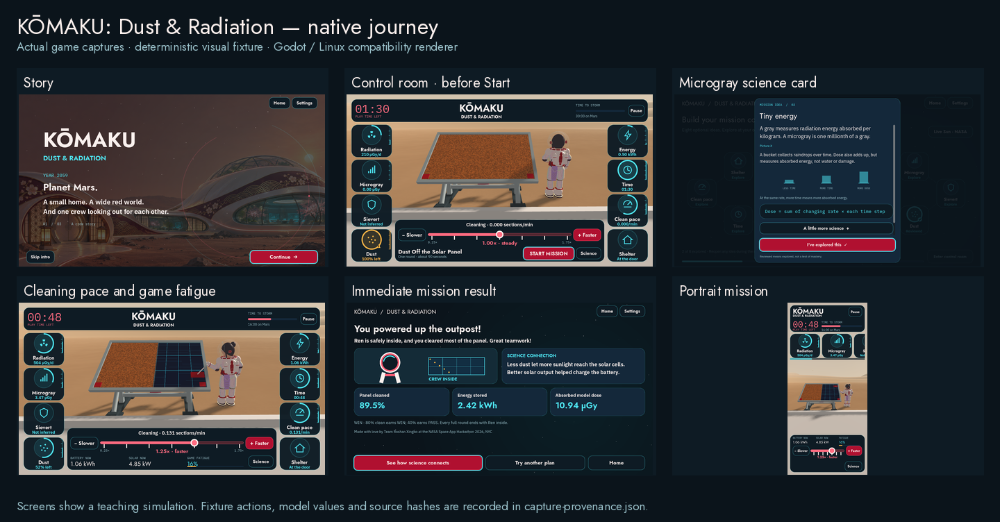

# <!-- brand:display_name -->KŌMAKU: Dust & Radiation<!-- /brand -->

**Clear the dust. Discover the science.**

A short Mars learning game for ages 7–12, built with Godot. From mission control, choose Ren's solar-panel cleaning pace and watch how dust, sunlight and stored energy connect. Eight optional science bubbles and an explanation of your own result make the ideas available when you need them.

[](https://github.com/roshaninfordham/NASA-SPACE-APPS-HACKATHON-2026/actions/workflows/validate.yml)

**Current source candidate: 0.9.0-alpha.1.** The new name, closer window view, larger controls, 90-second round and result-to-equation reveal are being prepared for release. Candidate work is not yet a published download. [Design and acceptance contract](docs/design-specs/JOURNEY-0.9.md) · [Candidate release notes](docs/releases/0.9.0-alpha.1.md) · [Submission draft for team review](docs/SUBMISSION-DRAFT.md).

**Latest published download: [0.8.0-alpha.1](https://github.com/roshaninfordham/NASA-SPACE-APPS-HACKATHON-2026/releases/tag/v0.8.0-alpha.1).** Published November 15, 2026 from `8b13e027ce5e0fa941a6bbeb1e09c5873b11baee`; its ten public assets were redownloaded and matched to the accepted build. That version keeps the earlier Shield Protocol name and five-minute standard round. [Release evidence](docs/evidence/release-0.8.0-alpha.1.json).



[Current candidate screenshots](docs/media/journey-0.9/README.md) · [Actual cleaning motion](docs/media/journey-0.9/cleaning-live.gif) · [Equation reveal](docs/media/journey-0.9/science-desktop.png). These are native Linux source captures with recorded fixtures and source provenance, not physical-device or published-installer acceptance.

## The 0.9 experience

1. **Three short story scenes:** exterior habitat → Ren → the interior control room. Large, separately rendered titles sit over unlettered illustrations, with optional sound and reduced motion.
2. **Choose a starting pace:** the control room opens in preflight. Inspect a bubble or adjust the pace, then press **START MISSION**. No reading-completion gate or running clock gets in the way.
3. **See the work clearly:** Ren and the panel fill more of the window. SLOWER, FASTER and a red stepped slider change the visible brushing pace. Dust clearing and the readings follow the same model.
4. **Finish a short round:** standard play takes about **90 active real seconds**, representing 30 simulated minutes. The large timer shows play time; a smaller clock explains mission time. Reading and Pause stop the whole simulation.
5. **Understand the ending:** Ren automatically enters the shelter. The result shows actual panel cleaning, battery energy and model dose. **See how science connects** brings the eight ideas together into four equation groups; **Back to results**, **Try another plan** and **Home** keep navigation clear.

The opening art is newly generated adaptation of the team's visual references, not an exact copy of the inline originals or a gameplay render. [Artwork provenance](game/assets/art/journey/provenance.json). The warning beeps are original synthesized project audio; the mentioned Drive recording was unavailable. [Audio credits](docs/AUDIO-CREDITS.md).

| Relationship                                | What the player can see                                                               |
| ------------------------------------------- | ------------------------------------------------------------------------------------- |
| Pace and fictional tiredness → cleaning     | A higher requested speed clears faster initially but can slow after tiredness builds. |
| Cleaner panel → more solar power            | Partial dust removal immediately improves modeled transmission.                       |
| Solar generation minus load → stored energy | Power is a rate in kW; energy accumulated over time is measured in kWh.               |
| Radiation rate over outside time → dose     | Dose accumulates over time; it is not a health bar or a measurement of the child.     |

WIN means at least 80% cleaned, PASS at least 40%, and TRY AGAIN below 40%. All outcomes put Ren inside. Because completed rounds share the same outside time and radiation curve, they share **10.9375 µGy** of model dose. Energy and dose explain the run; neither is a hidden extra win condition. There is no walking route, recall command, personal sievert calculation or future-energy reserve target. [Model and units](docs/TRAINING-MODEL.md).

**Controls:** 1 = slower, 3 = faster, Enter = Start in preflight, Escape = contextual Back/Pause and fullscreen exit, F11 = fullscreen. The earlier operator/EVA/lab activities remain under **Advanced lab · earlier mission**, with separate rules.

The [0.9 capture record](docs/media/journey-0.9/capture-provenance.json) documents the source and fixture used for the preview. Candidate source changes still require their own integrated and native-package acceptance. The [historical 0.8 gallery](docs/media/journey/README.md) and [live NASA observation](docs/media/journey/LIVE-SUN.md) remain labelled evidence for their recorded source snapshots. [Media](docs/MEDIA.md) · [Validation](docs/VALIDATION.md).

## Download the published game

GitHub **Release assets** contain runnable downloads; the Packages tab is not required. These links are the verified **0.8.0-alpha.1** files until the 0.9 candidate passes publication and public-file checks.

| Platform or document      | Published 0.8 asset                                                                                                                                                                |
| ------------------------- | ---------------------------------------------------------------------------------------------------------------------------------------------------------------------------------- |
| Apple Silicon / Intel Mac | [macOS universal ZIP](https://github.com/roshaninfordham/NASA-SPACE-APPS-HACKATHON-2026/releases/download/v0.8.0-alpha.1/KOMAKU-Shield-Protocol-0.8.0-alpha.1-macOS-universal.zip) |
| Windows x64               | [Windows ZIP](https://github.com/roshaninfordham/NASA-SPACE-APPS-HACKATHON-2026/releases/download/v0.8.0-alpha.1/KOMAKU-Shield-Protocol-0.8.0-alpha.1-Windows-x64.zip)             |
| Linux x64                 | [Linux ZIP](https://github.com/roshaninfordham/NASA-SPACE-APPS-HACKATHON-2026/releases/download/v0.8.0-alpha.1/KOMAKU-Shield-Protocol-0.8.0-alpha.1-Linux-x64.zip)                 |
| WebGL2 browser            | [Web export ZIP](https://github.com/roshaninfordham/NASA-SPACE-APPS-HACKATHON-2026/releases/download/v0.8.0-alpha.1/KOMAKU-Shield-Protocol-0.8.0-alpha.1-Web.zip)                  |
| Science guide for 0.8     | [Versioned PDF](https://github.com/roshaninfordham/NASA-SPACE-APPS-HACKATHON-2026/releases/download/v0.8.0-alpha.1/KOMAKU-Shield-Protocol-0.8.0-alpha.1-Science-Guide.pdf)         |

Extract the **whole ZIP** and read `START-HERE.txt`; native players need no editor or developer tools. Mac is ad-hoc signed without Apple Developer ID/notarization; Windows is unsigned. The Mac archive includes a consent-based helper that verifies integrity and changes quarantine only on the installed copy. Hosted launch checks do not establish physical M5 performance or approval by every device's security policy. [Installation](docs/DOWNLOADS.md) · [Mac repair](docs/MACOS-LAUNCH-REPAIR.md).

No production native Android or iOS installer is published. The Web export requires HTTP(S) hosting and WebGL2. Public hosting remains deferred by owner choice; there is no public play URL to include in a submission yet.

## Updates inside the desktop game

The compatible-content flow is **Update available → Install → Restart**. The game checks public GitHub releases at each fresh launch and on request, verifies a signed manifest and exact content size/hash, and retains recovery content. Notifications wait for safe menu/result points. There are no background notifications while the app is closed and no forced restart.

For the 0.9 candidate, the native update gate includes unchanged public **0.6.0, 0.6.1, 0.7.0, 0.7.1 and 0.8.0** Mac/Windows installers—ten platform/version jobs—plus the documented Linux 0.4 baseline. These are required checks, not a claim that the candidate has already passed them. The accepted 0.8 transitions retain their own evidence. Engine/bootstrap incompatibilities still require a full installer, and an app that cannot launch needs one corrected installation. [Update contract and evidence](docs/UPDATES.md).

The rename preserves application IDs, save locations, signing trust and the content-update contract. Existing installed app filenames can retain their original name while the updated game displays the new title. New 0.9 packages use `KOMAKU-Dust-and-Radiation`; historical assets keep their published filenames. [Shared branding](docs/BRANDING.md).

## Understand and present the science

The current documentation includes a [16-page illustrated science guide](docs/media/KOMAKU-Science-Guide.pdf), [technical equation sheet](docs/media/KOMAKU-Video-Equations.pdf), and [word-only equation sheet](docs/media/KOMAKU-Video-Equations-Simple.pdf). All three are included by the 0.9 packaging configuration, with source fingerprints checked before building. The 0.8 archives retain their earlier two packaged PDFs. [Readable guide](docs/SCIENCE-GUIDE.md) · [Simple equations](docs/VIDEO-EQUATIONS-SIMPLE.md) · [Result copy](docs/RESULT-SCREEN-COPY.md).

The historical **210 ±40 µGy/day** Curiosity RAD tissue-like detector observation supplies the baseline of an authored rising radiation curve. Pathfinder research reports a **0.28% per day decrease in solar-cell short-circuit current**; this supports the dust concept but is not a universal power-loss rate or runtime cleaning coefficient. Fatigue, deadline, panel transmission, load and battery specifications are explicit mission settings. [Source audit](docs/SCIENCE-JOURNEY-SOURCES.md) · [Complete source index](docs/SOURCE-INDEX.md).

The optional **NASA SDO solar view** requests the latest available AIA 193 Å image with online, stale, cached and bundled-fallback labels. This observational image does not drive the Mars dose curve, mission deadline or score. [Live-data contract](docs/LIVE-DATA.md).

For the team: [submission draft](docs/SUBMISSION-DRAFT.md), [55-word video narration and recording guide](docs/VIDEO-PITCH.md), [changelog](CHANGELOG.md), and [team briefing](docs/TEAM-STATUS.md). Submission text is a review draft; nothing has been submitted.

No account, ads, analytics, wearable health collection or cloud tutor is required. Preferences and limited progress stay local. GitHub supplies update discovery/downloads; the optional solar view contacts NASA; selected source links open in the system browser. The mission is playable offline. NASA does not endorse this project, and learning effectiveness still needs evaluation with the intended audience.

## Build and develop

The game uses **Godot 4.6.3**, typed GDScript, and the compatibility renderer. Godot supplies the C++ engine; Python handles packaging, validation, and PDF generation. [Engine decision](docs/ENGINE-DECISION.md).

```sh
godot --path game
python3 scripts/test_game.py
python3 scripts/test_updater.py
python3 scripts/build_science_guide.py --check
```

Open `game/project.godot` to develop the source. Exporting requires official templates and a project version matching the requested artifact. The **Build downloadable game** Actions workflow binds artifacts to a source commit; publication accepts those exact files after native gates. A code push is not a published release.

The JavaScript dashboard in `src/` is a tested earlier reference model. For that prototype, use Node 22.12+, `npm ci`, `npm run dev`, and `npm test`.

[Request tracker](docs/REQUEST-TRACKER.md) · [Roadmap](docs/ROADMAP.md) · [Architecture](docs/ARCHITECTURE.md) · [Design handoff](docs/DESIGN-HANDOFF.md) · [Playtest protocol](docs/PLAYTEST.md) · [Credits](CREDITS.md).

When reporting a problem, include the release version, device, operating system, steps, and exact error. Do not include personal information in public issues.

---

Made with love by Team Roshan Xingbo at the NASA Space App Hackathon 2026, NYC.
