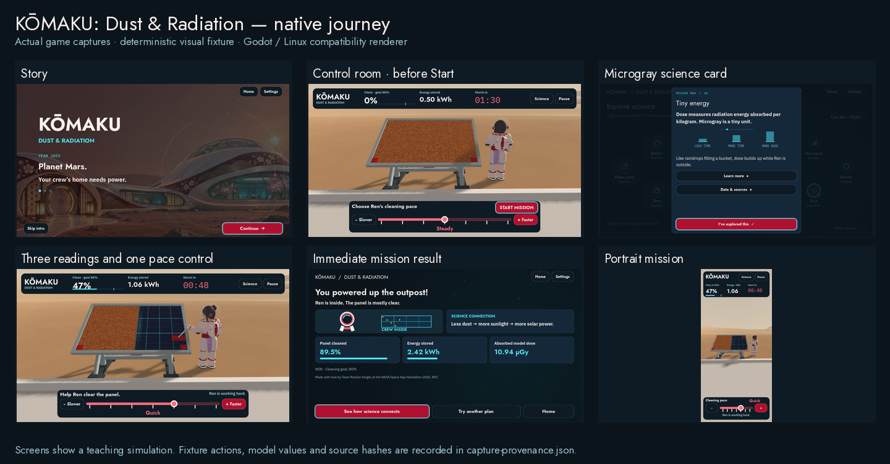

# <!-- brand:display_name -->KŌMAKU: Dust & Radiation<!-- /brand -->

**Clear the dust. Discover the science.**

A short Mars learning game for ages 7–12, built with Godot. From mission control, choose Ren's solar-panel cleaning pace and watch how dust, sunlight and stored energy connect. Three main readings keep play clear; an optional eight-concept Science library and an explanation of your own result make the ideas available when you need them.

[](https://github.com/roshaninfordham/NASA-SPACE-APPS-HACKATHON-2026/actions/workflows/validate.yml)

**Published [0.10.0-alpha.1](https://github.com/roshaninfordham/NASA-SPACE-APPS-HACKATHON-2026/releases/tag/v0.10.0-alpha.1) — November 15, 2026, 13:53:05 UTC.** Built from `26f19540baf330b00b0ac4a1b470d0e1439f7382`. This release simplifies the interface and corrects the installation handoff while preserving the 90-second mission and its equations. [Release notes](docs/releases/0.10.0-alpha.1.md). [Public-file verification](docs/evidence/release-0.10.0-alpha.1.json) matched all ten downloads to the accepted build; all four ZIPs contain the current instructions and exact three reviewed PDFs.



[0.10 gameplay screenshots](docs/media/journey-0.10/README.md) · [Science relationships](docs/media/journey-0.10/science-desktop.png) · [Submission draft](docs/SUBMISSION-DRAFT.md). These are native Linux source captures with recorded fixtures and source provenance, not physical-device or published-installer acceptance.

**Team feedback:** [Open the screen-review gallery](https://roshaninfordham.github.io/NASA-SPACE-APPS-HACKATHON-2026/review/) to draw boxes, arrows and pins, attach notes, and share an annotated screen or submit a GitHub issue. [Review guide](docs/SCREEN-REVIEW.md). This is a review gallery, not the playable browser edition.

## The 0.11 candidate

**In development: 0.11.0-alpha.1 candidate — not published.** The next interface restores the outpost-window presentation and eight visible science bubbles, with **View → Science window / Focused window**, direct Home navigation, and captioned radio feedback. It retains the 0.10 short wording, typography, 90-second mission and equations. [Candidate design contract](docs/design-specs/JOURNEY-0.11.md). Downloads and published acceptance below still refer to 0.10 until the new build passes its own release checks.

- **Science window** restores the visible outpost frame and eight concept bubbles whose readings follow the running mission. Opening an explanation pauses play. These are simulated readings; only the separate NASA viewer retrieves a solar image.
- **Focused window** offers a quieter view of the same mission through **View**. View changes do not change the rules or restart the round; the selected view is saved locally.
- **Menu** and **Settings** provide direct Home actions. Short player/Ren radio captions acknowledge Start and pace changes without microphone input or generated conversation.
- Local profile schema 2 adds the view preference while migrating recognized schema 1 progress and settings. The existing save identity and update trust remain unchanged.

Candidate source checks, new screenshots, exported startup and update evidence must be recorded separately. The existing 0.10 images retain their original source scope; they are not screenshots of the restored interface.

## The published 0.10 experience

1. **Start with a short story:** exterior habitat → Ren → the interior control room. Large titles and brief captions sit over unlettered illustrations, with optional sound and reduced motion. The first mission shows **Opening the window…** while preparing the scene; **Back to Home** cancels loading.
2. **Choose a starting pace:** preflight has no running clock. Set the pace and press **START MISSION**. There is no reading-completion gate.
3. **Focus on the cleaning:** the main view has **panel cleaned, energy stored and storm time**, with one red pace slider and Slower/Faster controls. Ren and the panel stay close to the window; brushing and visible dust follow the model.
4. **Discover science when curious:** **Science** pauses play and opens eight concept tiles. Each starts with a short explanation, diagram and everyday analogy. **Learn more** and **Data & sources** reveal the detailed model and original evidence when requested.
5. **Reach a clear ending:** standard play takes about **90 active real seconds**. Ren enters automatically and the result shows actual cleaning, battery energy and model dose. **See how science connects** merges the eight ideas into four short relationships; **Explore my numbers and graphs** opens the precise equations and run details. Back, retry and Home remain available.

The mission represents 30 simulated minutes. The main timer shows real play time; **Time → Learn more** explains simulated time. Reading and Pause freeze all mission quantities together. Softer optional pace and discovery sounds support the existing visible warnings and audio controls.

The opening art is newly generated adaptation of the team's visual references, not an exact copy of the inline originals or a gameplay render. [Artwork provenance](game/assets/art/journey/provenance.json). The warning beeps are original synthesized project audio; the mentioned Drive recording was unavailable. [Audio credits](docs/AUDIO-CREDITS.md).

| Relationship                                | What the player can see                                                               |
| ------------------------------------------- | ------------------------------------------------------------------------------------- |
| Pace and fictional tiredness → cleaning     | A higher requested speed clears faster initially but can slow after tiredness builds. |
| Cleaner panel → more solar power            | Partial dust removal immediately improves modeled transmission.                       |
| Solar generation minus load → stored energy | Power is a rate in kW; energy accumulated over time is measured in kWh.               |
| Radiation rate over outside time → dose     | Dose accumulates over time; it is not a health bar or a measurement of the child.     |

WIN means at least 80% cleaned, PASS at least 40%, and TRY AGAIN below 40%. All outcomes put Ren inside. Because completed rounds share the same outside time and radiation curve, they share **10.9375 µGy** of model dose. Energy and dose explain the run; neither is a hidden extra win condition. There is no walking route, recall command, personal sievert calculation or future-energy reserve target. [Model and units](docs/TRAINING-MODEL.md).

**Controls:** 1 = slower, 3 = faster, Enter = Start in preflight, Escape = contextual Back/Pause and fullscreen exit, F11 = fullscreen. The earlier operator/EVA/lab activities remain under **Advanced lab · earlier mission**, with separate rules.

The [0.10 capture record](docs/media/journey-0.10/capture-provenance.json) documents 135 states across five viewports, with zero layout findings and recorded unchanged source fingerprints. Source validation, native Linux navigation, exported Mac/Windows startup and the supported native content-update matrix passed. These are separately scoped checks; they do not establish physical-device performance. The [historical 0.9 gallery](docs/media/journey-0.9/README.md) keeps its original source and fixture record. The [historical 0.8 gallery](docs/media/journey/README.md) and [live NASA observation](docs/media/journey/LIVE-SUN.md) remain labelled evidence for their recorded source snapshots. [Media](docs/MEDIA.md) · [Validation](docs/VALIDATION.md).

## Download and open this version

**Latest published download: 0.10.0-alpha.1.** The 0.11 candidate is not yet available as a published release. [Official version page](https://github.com/roshaninfordham/NASA-SPACE-APPS-HACKATHON-2026/releases/tag/v0.10.0-alpha.1) lists publication status and available files. Download the matching platform ZIP below, then extract the whole archive.

| Platform                  | 0.10.0 archive                                                                                                                                                                          | Open after extracting the whole ZIP                  |
| ------------------------- | --------------------------------------------------------------------------------------------------------------------------------------------------------------------------------------- | ---------------------------------------------------- |
| Mac Apple Silicon / Intel | [macOS universal ZIP](https://github.com/roshaninfordham/NASA-SPACE-APPS-HACKATHON-2026/releases/download/v0.10.0-alpha.1/KOMAKU-Dust-and-Radiation-0.10.0-alpha.1-macOS-universal.zip) | `KŌMAKU- Dust and Radiation.app`                     |
| Windows x64               | [Windows ZIP](https://github.com/roshaninfordham/NASA-SPACE-APPS-HACKATHON-2026/releases/download/v0.10.0-alpha.1/KOMAKU-Dust-and-Radiation-0.10.0-alpha.1-Windows-x64.zip)             | `KOMAKU-Dust-and-Radiation.exe`                      |
| Linux x64                 | [Linux ZIP](https://github.com/roshaninfordham/NASA-SPACE-APPS-HACKATHON-2026/releases/download/v0.10.0-alpha.1/KOMAKU-Dust-and-Radiation-0.10.0-alpha.1-Linux-x64.zip)                 | `KOMAKU-Dust-and-Radiation.x86_64`                   |
| WebGL2 browser            | [Web export ZIP](https://github.com/roshaninfordham/NASA-SPACE-APPS-HACKATHON-2026/releases/download/v0.10.0-alpha.1/KOMAKU-Dust-and-Radiation-0.10.0-alpha.1-Web.zip)                  | Serve over HTTP(S); do not double-click `index.html` |

Read `START-HERE.txt` and the [current installation guide](docs/DOWNLOADS.md). Native players need no editor or developer tools. Mac is ad-hoc signed without Developer ID/notarization; Windows is unsigned. The Mac archive includes **Install KŌMAKU.command**, a consent-based helper for a trusted download. Hosted tests do not establish every security-policy path or physical M5 performance.

GitHub Release assets contain the game; the Packages tab and source-code ZIP are not installers. No production native Android/iOS installer or public hosted play URL is supplied. Hosting remains deferred by owner choice. All three science/equation PDFs are included in this package.

## Updates inside the desktop game

The compatible-content flow is **Update available → Install → Restart**. The game checks public GitHub releases at each fresh launch and on request, verifies a signed manifest and exact content size/hash, and retains recovery content. Notifications wait for safe menu/result points. There are no background notifications while the app is closed and no forced restart.

For the 0.10.0 update, the native update gate includes unchanged public **0.6.0, 0.6.1, 0.7.0, 0.7.1, 0.8.0 and 0.9.0** Mac/Windows installers—twelve platform/version jobs—plus the documented Linux 0.4 baseline. All twelve jobs and the Linux baseline passed activation, repeated healthy startup and same-size corruption recovery on the accepted signed pack. These use local artifact bytes, not a new HTTP/notification/relaunch test. Historical transitions retain their own evidence. Engine/bootstrap incompatibilities still require a full installer, and an app that cannot launch needs one corrected installation. [Update contract and evidence](docs/UPDATES.md).

The rename preserves application IDs, save locations, signing trust and the content-update contract. Existing installed app filenames can retain their original name while the updated game displays the new title. New 0.10.0 packages use `KOMAKU-Dust-and-Radiation`; historical assets keep their published filenames. [Shared branding](docs/BRANDING.md).

## Understand and present the science

The current documentation includes a [16-page illustrated science guide](docs/media/KOMAKU-Science-Guide.pdf), [technical equation sheet](docs/media/KOMAKU-Video-Equations.pdf), and [word-only equation sheet](docs/media/KOMAKU-Video-Equations-Simple.pdf). All three were fingerprint-checked before building and verified byte-for-byte in every public 0.10.0 platform archive. The 0.8 archives retain their earlier two packaged PDFs. [Readable guide](docs/SCIENCE-GUIDE.md) · [Simple equations](docs/VIDEO-EQUATIONS-SIMPLE.md) · [Result copy](docs/RESULT-SCREEN-COPY.md).

The historical **210 ±40 µGy/day** Curiosity RAD tissue-like detector observation supplies the baseline of an authored rising radiation curve. Pathfinder research reports a **0.28% per day decrease in solar-cell short-circuit current**; this supports the dust concept but is not a universal power-loss rate or runtime cleaning coefficient. Fatigue, deadline, panel transmission, load and battery specifications are explicit mission settings. [Source audit](docs/SCIENCE-JOURNEY-SOURCES.md) · [Complete source index](docs/SOURCE-INDEX.md).

The optional **NASA SDO solar view** requests the latest available AIA 193 Å image with online, stale, cached and bundled-fallback labels. This observational image does not drive the Mars dose curve, mission deadline or score. [Live-data contract](docs/LIVE-DATA.md).

For the team: [copy-ready submission answers](docs/SUBMISSION-COPY-PASTE.md), [longer draft](docs/SUBMISSION-DRAFT.md), [55-word video narration and recording guide](docs/VIDEO-PITCH.md), [changelog](CHANGELOG.md), and [team briefing](docs/TEAM-STATUS.md). Submission text is a review draft; nothing has been submitted.

No account, ads, analytics, wearable health collection or cloud tutor is required. Preferences and limited progress stay local. GitHub supplies update discovery/downloads; the optional solar view contacts NASA; selected source links open in the system browser. The mission is playable offline. NASA does not endorse this project, and learning effectiveness still needs evaluation with the intended audience.

## Build and develop

The game uses **Godot 4.6.3**, typed GDScript, and the compatibility renderer. Godot supplies the C++ engine; Python handles packaging, validation, and PDF generation. [Engine decision](docs/ENGINE-DECISION.md).

```sh
godot --path game
python3 scripts/test_game.py
python3 scripts/test_updater.py
python3 scripts/build_science_guide.py --check
```

Open `game/project.godot` to develop the source. Exporting requires official templates and a project version matching the requested artifact. The **Build downloadable game** Actions workflow binds artifacts to a source commit; publication accepts those exact files after native gates. A code push is not a published release.

The JavaScript dashboard in `src/` is a tested earlier reference model. For that prototype, use Node 22.12+, `npm ci`, `npm run dev`, and `npm test`.

[Request tracker](docs/REQUEST-TRACKER.md) · [Roadmap](docs/ROADMAP.md) · [Architecture](docs/ARCHITECTURE.md) · [Design handoff](docs/DESIGN-HANDOFF.md) · [Playtest protocol](docs/PLAYTEST.md) · [Credits](CREDITS.md).

When reporting a problem, include the release version, device, operating system, steps, and exact error. Do not include personal information in public issues.

---

Made with love by Team Roshan Xingbo at the NASA Space App Hackathon 2026, NYC.
