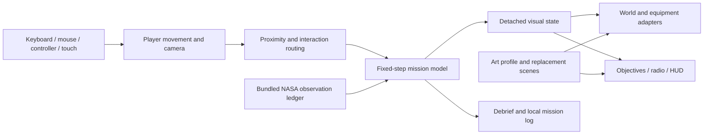

# Red Veil system architecture

## Primary game runtime

Godot 4.6.3 with typed GDScript and the compatibility renderer. The game is an offline first-person adventure. It has no account system, remote gameplay service, analytics SDK, or runtime dependency on a research API. The updater can contact public GitHub release endpoints without sending learner profiles or mission logs.

| Module                             | Responsibility                                                  | Must not own                              |
| ---------------------------------- | --------------------------------------------------------------- | ----------------------------------------- |
| `game/scripts/mission.gd`          | Energy, exposure, dust, inspection, terminal rules, baseline    | Scene geometry, input, sound, network     |
| `game/scripts/player.gd`           | Movement, gravity, camera, instrument presentation              | Resource-budget rules                     |
| `game/scripts/world.gd`            | World construction, collisions, weather presentation, art slots | Mission outcome logic                     |
| `game/scripts/game.gd`             | Interaction routing, mission clock, radio, UI binding           | Scientific source values                  |
| `game/scripts/art_profile.gd`      | Scene, palette, font, and rendering-budget choices              | Physics or safety thresholds              |
| `game/data/nasa-observations.json` | Units and provenance of sourced numerical observations          | Invented weather presented as measurement |
| `scripts/build_game.py`            | Tests, exports, notices, checksums, manifest                    | Implicit publication                      |

The simulation updates in fixed steps of 1/120 hour. Four real minutes represent twelve fictional mission hours. Character movement uses real-time Godot physics and 3.71 m/s² gravity; the mission clock is deliberately compressed. This is a teaching abstraction, not a consistently time-scaled physical reconstruction.

Native inspection is a physical hold-to-interact task. Its illustrative work-duration parameter is shorter than the earlier dashboard's passive inspection. The refuge is entered by walking into its spatial bounds; exposure continues while walking. There is no scripted return-time teleport in the first-person implementation.

## Local learning boundary

The academy reads authored lesson data and calls a separate local tutor. Independent answers update a bounded Bayesian estimate; hints and repeated same-day prompts do not. Mission outcomes select a support topic without awarding mastery. The tutor never changes the mission equations. A bounded profile uses a pending file and previous-valid backup, with in-game reset. No learning telemetry leaves the device. [Learning design](LEARNING-DESIGN.md) records parameters, research and evaluation gaps.

## Design-team replacement boundary

Scene slots, shared palette/font settings, a custom HUD contract, and detached visual snapshots are implemented. See [design handoff](DESIGN-HANDOFF.md). A visual replacement preserves existing collision geometry. A different footprint, doorway, shelter volume, or interaction distance requires a gameplay change and validation.

This does not make every future engine change free. It makes presentation changes local and keeps numerical rules testable. The current orchestration module still contains the fallback HUD builder; design-owned HUD scenes are the intended route for larger interface pivots.

## Earlier web prototype

The repository-root Vite/Three.js application remains a reference prototype and independent model testbed. Its modules are `src/scenarios.js`, `src/simulation.js`, `src/scene.js`, `src/view.js`, and `src/main.js`. It must not be mistaken for the final game. The two implementations share source observations and scientific principles; their interaction-specific timing differs and is documented rather than claimed equivalent.

## Performance and privacy

The Godot art profile caps frame rate and particle count and can disable shadows. Assets are local. Short sound effects come from a licensed source. Bounded mission state is saved in a local JSON log, with no personal fields. Native memory, battery use, and thermal behavior are not yet characterized on the target M5 or mobile hardware. Do not call the implementation the lowest-resource engine choice without comparative measurements.

## Update and recovery boundary

The first autoload captures the bundled verification key and compatibility contract, verifies a candidate's manifest and exact bytes, and mounts a selected PCK before main-scene preloads. A ready/trial/healthy journal retains a previous verified pack. The main scene acknowledges only startup readiness. Signature, engine/runtime mismatch, failed mount, or unacknowledged startup selects recovery or the bundled game. Private signing keys never enter the application.

A persistent client checks bounded public GitHub metadata, verifies signatures before downloading code, streams a size-limited pack, stages it, and requests explicit restart. The interface defers notices during missions. A new engine, trust root, or incompatible runtime contract takes the full-installer path. Desktop source previews use a separate development update cache; editor imports and script tests do not mount player updates. A crash during a storage mutation can leave a conservative lock requiring explicit repair after other game windows are closed. See [update guarantees and limits](UPDATES.md).

## Release process

The pinned engine/template installer verifies SHA-512 against the official release manifest. The build script runs native checks, exports four targets, smoke-tests the exported Linux binary, packages attribution and documentation, and emits SHA-256 checksums plus a source-commit manifest. The manual GitHub workflow produces downloadable CI artifacts; public game downloads are separately published as Release assets. Native signing and store distribution are separate release gates.
