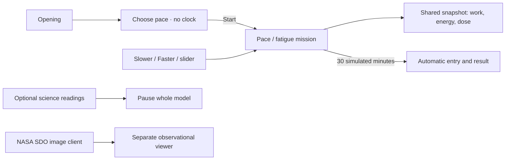
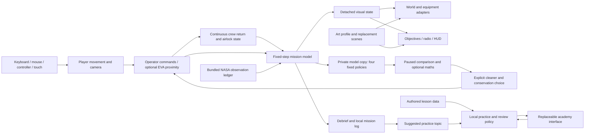

# <!-- brand:display_name -->KŌMAKU: Shield Protocol<!-- /brand --> system architecture

**Reviewed November 14, 2026.** This describes the primary game and current update implementation. [Team status](TEAM-STATUS.md) identifies the current published release and scoped acceptance evidence; [roadmap](ROADMAP.md) tracks browser/mobile work that is not yet a verified deployment.

## Primary game runtime

Godot 4.6.3 with typed GDScript and the compatibility renderer. The game is an offline first-person adventure. It has no account system, remote gameplay service, analytics SDK, or runtime dependency on a research API. The updater can contact public GitHub release endpoints without sending learner profiles or mission logs. An optional Live Sun viewer fetches the latest available NASA SDO image directly over HTTPS; cached and bundled images keep the lesson available offline. It never changes mission equations.

## Default 0.8 journey

The final source direction follows the words-only workflow: opening → control-room preflight → explicit Start → fixed-duration pace/fatigue cleaning → automatic entry → equations. Optional science exploration is not a prerequisite for playing. The [independent v4 numerical audit](evidence/pace-model-0.8-audit.json) is recorded; final controller/package acceptance remains pending.

`game/scripts/pace_mission.gd` owns the new deterministic model: bounded requested pace and fictional fatigue, integrated work, continuous dust transmission, actual generation/load/battery energy, authored dose ramp and cleanliness outcome. It has no walking, recall or future reserve calculation. Views do not maintain independent physics counters. The earlier `training_mission.gd` describes a superseded prototype, not the final default contract.

`journey_game.gd` coordinates preflight/play/pause/debrief and shared components. `journey_shell.gd` presents the opening, optional concepts and reflection; `training_hud.gd` presents the window controls and current values. Shared branding/theme/audio and the catalog remain replaceable. `journey_progress.gd` saves only bounded local preferences, explored IDs and run summaries; historical quiz identities stay distinct.

The root-last input guard routes fullscreen Escape before nested dialogs. Reading, focus loss and navigation freeze every model quantity. Keys 1/3 adjust pace only in exposed preflight or active controls; Enter starts only in preflight. No hidden control receives shortcuts beneath a modal.

The NASA SDO client is a separate HTTPS/cache boundary for browse imagery. It does not set the mission's authored radiation curve, fatigue or score. See [LIVE-DATA.md](LIVE-DATA.md). The persistent `/root/Updates` client and stable update/save identities remain unchanged; notices are deferred to safe screens, and downloads/restart require explicit actions.

## Retained advanced-lab runtime

The following diagram and boundaries describe the earlier mission, available from Home → Advanced lab. They are not the default 0.8 cleaning/energy rules.

| Module                                   | Responsibility                                                                     | Must not own                                       |
| ---------------------------------------- | ---------------------------------------------------------------------------------- | -------------------------------------------------- |
| `game/scripts/mission.gd`                | Energy, exposure, dust, inspection, terminal rules, baseline                       | Scene geometry, input, sound, network              |
| `game/scripts/companion_rescue.gd`       | Authored continuous crew route, airlock cycle and indoor-entry state               | Radiation/energy equations, input or geometry      |
| `game/scripts/player.gd`                 | Movement, gravity, camera, instrument presentation                                 | Resource-budget rules                              |
| `game/scripts/world.gd`                  | World construction, collisions, weather presentation, art slots                    | Mission outcome logic                              |
| `game/scripts/game.gd`                   | Interaction routing, mission clock, radio, UI binding                              | Scientific source values                           |
| `game/scripts/art_profile.gd`            | Scene, palette, font, and rendering-budget choices                                 | Physics or safety thresholds                       |
| `game/data/nasa-observations.json`       | Units and provenance of sourced numerical observations                             | Invented weather presented as measurement          |
| `game/scripts/learning.gd`               | Local practice estimates, question rotation, review policy and recoverable profile | Mission physics, cloud telemetry or visual styling |
| `game/scripts/academy.gd`                | Practice interface, hints, explanations and reset                                  | Scientific equations or signing decisions          |
| `game/updater/bootstrap.gd` / `store.gd` | Pinned trust root, verified slots, activation journal and startup recovery         | Network discovery or learner records               |
| `game/updater/client.gd` / `panel.gd`    | Public release checks, bounded download, progress and explicit restart controls    | Deciding that unverified code is safe              |
| `scripts/build_game.py`                  | Tests, exports, notices, checksums, manifest                                       | Implicit publication                               |

The simulation updates in fixed steps of 1/120 hour. Four real minutes represent twelve fictional mission hours. Character movement uses real-time Godot physics and 3.71 m/s² gravity; the mission clock is deliberately compressed. This is a teaching abstraction, not a consistently time-scaled physical reconstruction.

The retained advanced-lab presentation puts the operator inside a bounded control room. The single suit and dose state belongs to Mira outside, independent of operator position. A separate crew-return controller handles the authored approach and airlock cycle; only completed arrival/cycling changes the mission shelter flag. These are game travel settings, not a validated airlock or human locomotion simulation.

The optional EVA mission retains physical hold-to-inspect and walking into the refuge bounds. In that mode, suit and dose refer to the first-person explorer. Both modes use the same numerical mission model, but their interaction and tracked-subject rules are explicit. The operator mode leaves the off-view array uninspected at its existing 0.75 efficiency factor.

The art profile selects the window presentation. World categories hide exterior infrastructure and disable its collision bodies while preserving their original state for a return to EVA. The indoor enclosure and operator movement area remain active. Presentation flags never set shielding, repair equipment or change battery values.

## Local learning boundary

The academy reads authored lesson data and calls a separate local tutor. Independent answers update a bounded Bayesian estimate; hints and repeated same-day prompts do not. Mission outcomes select a support topic without awarding mastery. The tutor never changes the mission equations. A bounded profile uses a pending file and previous-valid backup, with in-game reset. No learning telemetry leaves the device. [Learning design](LEARNING-DESIGN.md) records parameters, research and evaluation gaps.

## Mission-planning boundary

The local adviser copies the current mission into a private model and runs the same fixed-step equations for four fixed cleaner/conservation combinations. It never applies actions, advances the live mission or predicts a walking route or future crew-return/airlock transition. A projection holds the current shelter state fixed; its label must make that restriction visible during a rescue. The planner presents energy, optional research, exposure, suit reserve and abort duration separately; explicit application changes only the two chosen switches. AEGIS is a transparent scenario preview, not a trained model or live NASA forecast. [Contract, equations and limits](MISSION-PLANNER.md).

The game controller owns pausing, focus, movement and applying user intent. The report UI owns presentation only. Adviser tests exercise numerical comparison and non-mutation; integration tests use real input/menu paths at four viewport sizes.

## Design-team replacement boundary

Scene slots, shared palette/font settings, a custom HUD contract, and detached visual snapshots are implemented. See [design handoff](DESIGN-HANDOFF.md). A visual replacement preserves existing collision geometry. A different footprint, doorway, shelter volume, or interaction distance requires a gameplay change and validation.

This does not make every future engine change free. It makes presentation changes local and keeps numerical rules testable. The current orchestration module still contains the fallback HUD builder; design-owned HUD scenes are the intended route for larger interface pivots.

## Two distinct browser paths

The exported Godot game is the browser version of the first-person experience. Offline/cache/update packaging is implemented and browser-tested. Public hosting is deferred by owner choice because the prior Pages URL inherited an unrelated custom-domain redirect. Automatic deployment remains disabled until a game address is chosen. A Web ZIP, locally served preview, installable PWA and public HTTPS deployment are different delivery states. Browser/mobile readiness is tracked in [the roadmap](ROADMAP.md); desktop checks do not establish Safari, iOS or Android support.

### Earlier reference prototype

The repository-root Vite/Three.js application remains a reference prototype and independent model testbed. Its modules are `src/scenarios.js`, `src/simulation.js`, `src/scene.js`, `src/view.js`, and `src/main.js`. It must not be mistaken for the final game. The two implementations share source observations and scientific principles; their interaction-specific timing differs and is documented rather than claimed equivalent.

## Performance and privacy

The Godot art profile caps frame rate and particle count and can disable shadows. Assets are local. Short sound effects come from a licensed source. Bounded mission state is saved in a local JSON log, with no personal fields. Native memory, battery use, and thermal behavior are not yet characterized on the target M5 or mobile hardware. Do not call the implementation the lowest-resource engine choice without comparative measurements.

## Shared validation

`scripts/test_game.py` is the authoritative Linux native-game suite used by development, CI and release exports. It imports the project, isolates user data, rejects Godot script/engine errors even when the process exits zero, and runs the same model, interface, performance and update checks in each route. Native Mac/Windows release checks run the exported archives separately. This avoids adding a new feature test to CI while accidentally omitting it from the release gate.

## Update and recovery boundary

The first autoload captures the bundled verification key and compatibility contract, verifies a candidate's manifest and exact bytes, and mounts a selected PCK before main-scene preloads. A ready/trial/healthy journal retains a previous verified pack. The main scene acknowledges only startup readiness. Signature, engine/runtime mismatch, failed mount, or unacknowledged startup selects recovery or the bundled game. Private signing keys never enter the application.

A persistent client checks bounded public GitHub metadata, verifies signatures before downloading code, streams a size-limited pack, stages it, and requests explicit restart. The interface defers notices during missions. A new engine, trust root, or incompatible runtime contract takes the full-installer path. Desktop source previews use a separate development update cache; editor imports and script tests do not mount player updates. A crash during a storage mutation can leave a conservative lock requiring explicit repair after other game windows are closed. See [update guarantees and limits](UPDATES.md).

## Release process

The pinned engine/template installer verifies SHA-512 against the official release manifest. The build script runs native checks, exports four targets, smoke-tests the exported Linux binary, packages attribution and documentation, and emits SHA-256 checksums plus a source-commit manifest. The build workflow produces downloadable CI artifacts from a clean exact source revision. An accepted-artifact publication workflow can upload those same bytes to a matching draft without rebuilding; source, tag, manifest, signature and file hashes remain bound together. Public game downloads are Release assets. Native application signing/notarization, Android packaging and store distribution are separate release gates.

Published 0.4.0-alpha.1 from `48901d0` passed Linux fixture-to-production-content acceptance using its actual signature and pack bytes. A GUI pass also exercised real `OS.create_instance` relaunch into healthy production content under authenticated Xvfb/Mesa. The fixture is not an earlier shipped installer and transport was local; physical Mac/Windows, real HTTP pack transfer, physical GPU/visual quality and audio remain unverified. Live GitHub metadata connectivity was checked separately. See [team status](TEAM-STATUS.md) for exact evidence and remaining device/network gaps.

## Android and iOS delivery boundary

Android uses a separate export-preset template and isolated build helper. The internal validation artifact has a distinct `.internal` package and disposable signing identity. A future production APK needs a stable app keystore, increasing version code and tested OS installation/upgrade flow; the existing content-update RSA key is a separate trust purpose. Native mobile content installation remains guarded off. The iOS near-term route is browser/PWA delivery subject to real Safari/device checks; no generic GitHub IPA installation or native iOS update capability is claimed. [Mobile distribution](MOBILE-DISTRIBUTION.md) records tools, evidence and platform requirements.

## Maintenance and ownership

The mission model, learner policy, presentation, updater and release tooling have separate responsibilities. Removing a file requires checking its entrypoint, test, build and documentation uses. The earlier model and source brief are retained intentionally; their presence is not evidence of dead code. New cross-module changes follow [parallel ownership and integration rules](PARALLEL-DEVELOPMENT.md), with one integration owner running the combined checks and serializing Git/release operations.
