# <!-- brand:display_name -->KŌMAKU: Shield Protocol<!-- /brand --> media gallery

## 0.6 — specification implementation

Actual Godot renders of the current visual-development alpha: a live Suit Lab, habitat lessons, expanded mission-control screens and ornamented architecture. These remain stylized procedural interpretations; they do not match the concept illustrations pixel for pixel. [Capture hashes and source provenance](media/komaku-0.6.0-alpha.1-capture.json).

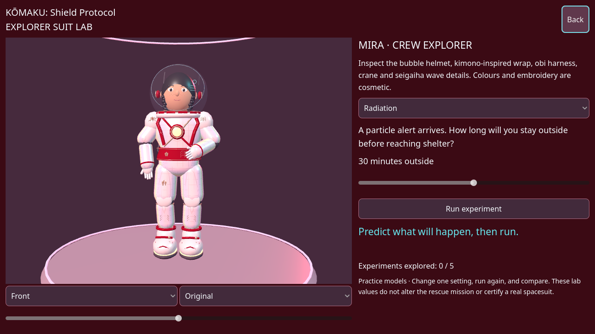

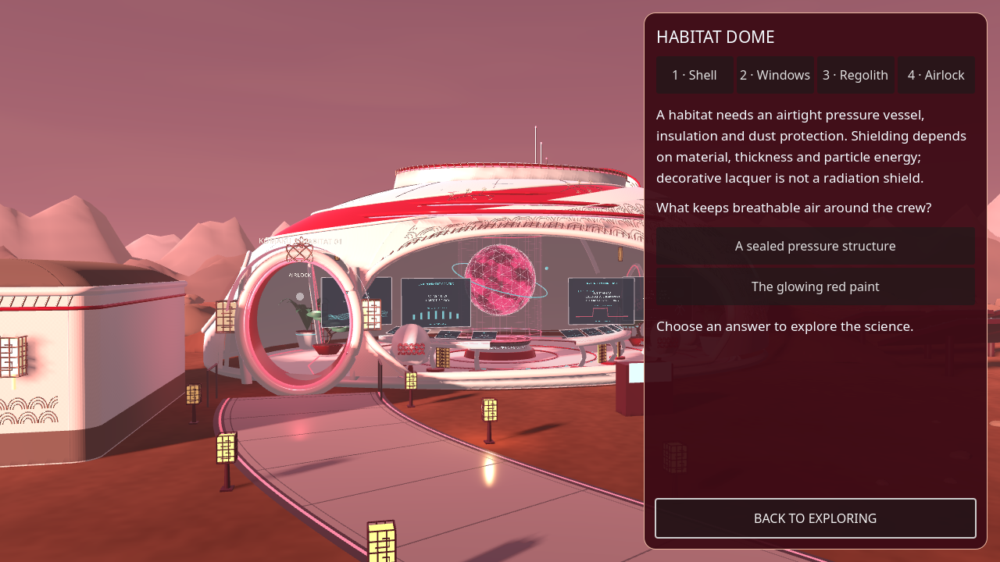

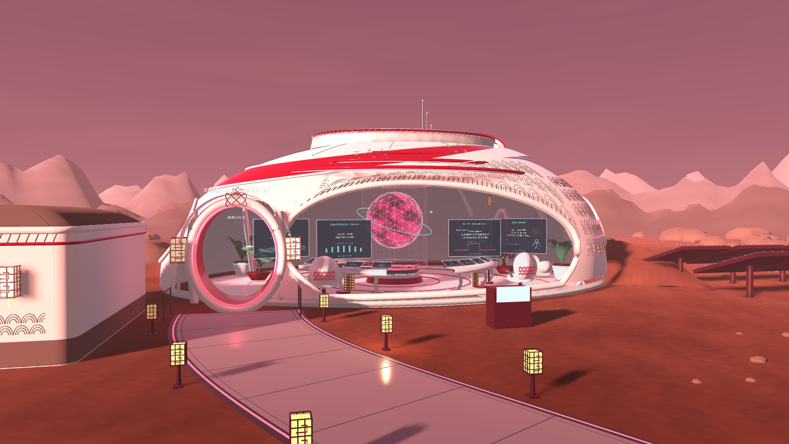

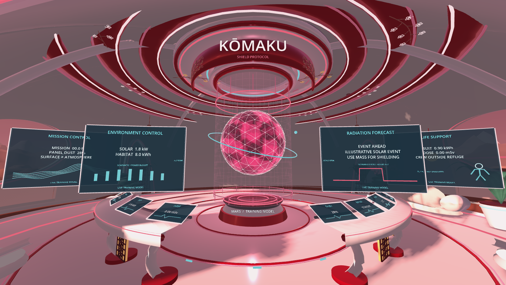

[Wide control-room view](media/komaku-0.6.0-alpha.1-interior.png) · [Mira](media/komaku-0.6.0-alpha.1-astronaut.png) · [Title menu](media/komaku-0.6.0-alpha.1-title.png)

| Layout             | Suit Lab                                              | Habitat Field Notes                                      |
| ------------------ | ----------------------------------------------------- | -------------------------------------------------------- |
| Portrait, 390×844  | [View](media/komaku-0.6.0-alpha.1-suit-portrait.png)  | [View](media/komaku-0.6.0-alpha.1-habitat-portrait.png)  |
| Landscape, 844×390 | [View](media/komaku-0.6.0-alpha.1-suit-landscape.png) | [View](media/komaku-0.6.0-alpha.1-habitat-landscape.png) |

The six UI captures use source `0ae2bff760242437e85bd51fb5615c65fe5e7ed5` with a clean checkout. Release source `c0beba698c32741fb17f6c8e9ec44fd6bb875852` adds a title-menu height correction and its regression check; the depicted exhibit code is unchanged. World review cameras show the same 3D artwork from the preceding implementation commit; the manifest records that distinction and the close-view camera. All images come from Godot/Mesa software rendering. They are layout/design evidence, not physical-phone or frame-rate validation. Some callout anchors are obscured by the lesson card; the tabs remain available.

Reproduce the interface captures with `python3 scripts/capture_spec_review.py --output /tmp/komaku-review --xvfb /path/to/Xvfb`. The runner checks rendered lesson-card bounds and records hashes. To capture a fixed world view, use the Godot command in the historical section below.

## Historical 0.5 visual pass

These are actual Godot 4.6.3 renders of the **0.5.0-alpha.1** visual candidate, associated with release source `1b4d1b8e0907f76a055a8aca85e1073c4eff34eb`. They show original procedural interpretations of the design team's reference images. Final photoreal materials, character rigging and pixel-perfect likeness remain unfinished.

## Walk through the habitat

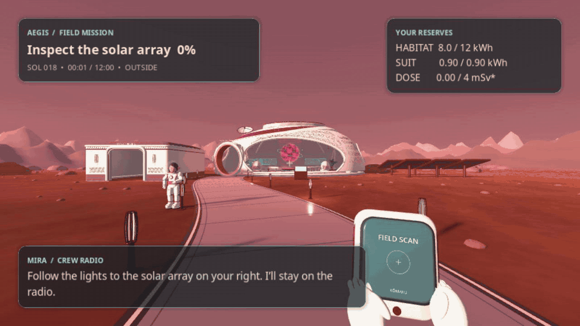

The 7.1-second GIF uses ordinary movement/look/visor input and a fixed-timestep recording. Its 960×540, 10fps encoding and software-rendered capture are presentation choices, not real-device frame-rate evidence. It has no audio and does not show a completed mission or rescue campaign.

## Environment and character


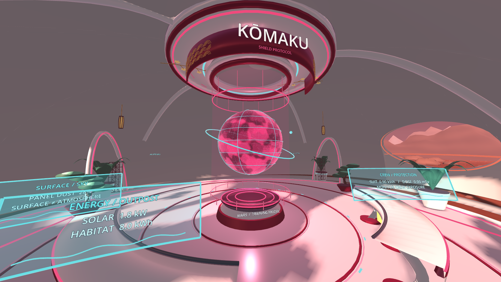

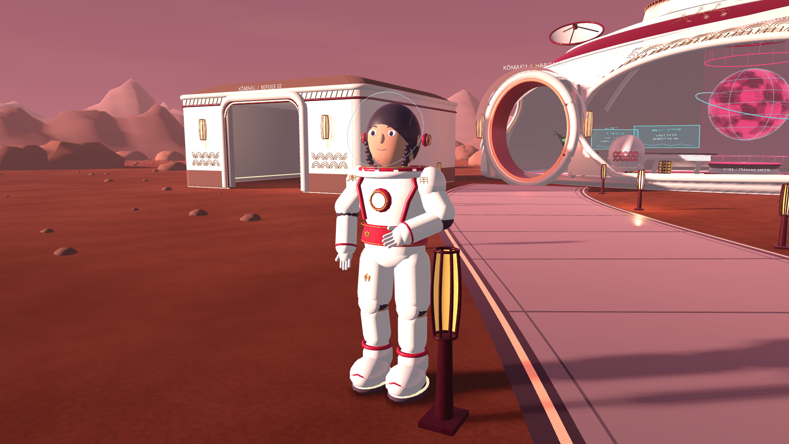

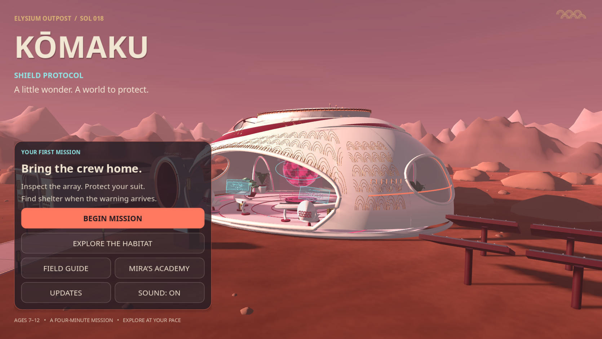

[First-person HUD](media/komaku-0.5.0-alpha.1-gameplay.png) · [Portrait layout](media/komaku-0.5.0-alpha.1-portrait.png)

The environment/character shots use repeatable review cameras; gameplay uses the normal player camera. The portrait image is a 390×844 desktop viewport, not physical-phone validation; the handheld scanner is partly clipped at narrow aspect. The [capture manifest](media/komaku-0.5.0-alpha.1-capture.json) records exact source distinctions, file hashes, input-driver code, rendering counts and limitations. These are source-project captures, not photographs or images of a downloaded native installer.

To reproduce a fixed view with an available graphics display:

```sh
godot --path game --script res://tests/capture_visuals.gd -- --view interior --output /tmp/komaku-interior.png
```

Other views: `exterior`, `astronaut`, `title`. Linux CI-style rendering can use an authenticated Xvfb display; software-renderer results do not establish physical GPU performance.

---

# Historical Red Veil 0.4 media

These are captures of the **0.4.0-alpha.1 Web build**, exported from source `48901d0bce68e72974b36377c3a060f90403ebe9` and captured on November 14, 2026. They show the historical mechanics alpha: provisional geometry, materials, characters, interface, and animation. They are actual game screens and keyboard/mouse gameplay, not concept art or generated promotional images.

## First-person gameplay


This 20-second recording (3.93 MiB) shows starting a mission, looking toward the solar array, walking, and switching on visor cleaning. It does not depict a completed mission or demonstrate educational effectiveness. The GIF has no audio. Its 960 × 540 resolution, 10 fps encoding, and software-rendered browser capture are presentation choices, not a game performance benchmark.

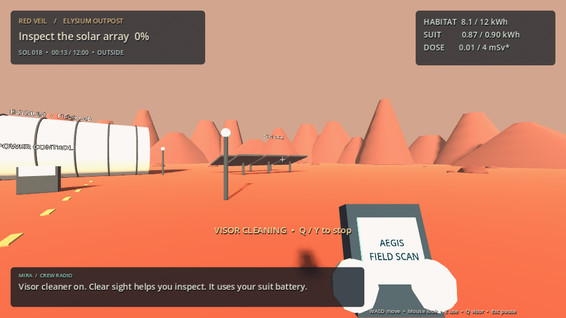

## Title and practice screens

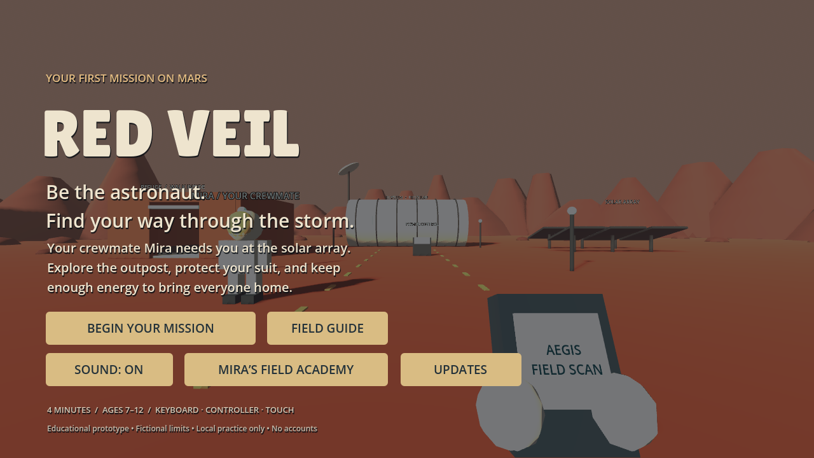


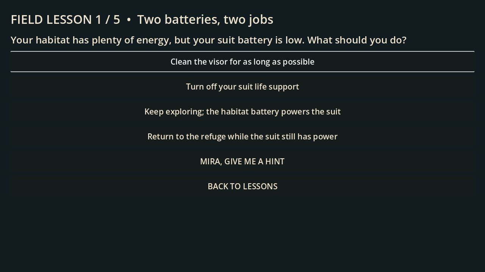

The title and academy stills are 1280 × 720. The [capture manifest](media/red-veil-0.4.0-alpha.1-capture.json) records file hashes and provenance. Answer order is shuffled by the game, so a later capture may show a different order. The practice content is authored and the review estimates are provisional; see [learning design](LEARNING-DESIGN.md).

## Reproduce the captures

Use the matching versioned Web release, serve its extracted files over HTTP, and check its release manifest/source first. The capture command records the supplied version and commit; it does not independently authenticate those labels.

Prerequisites are the repository's pinned Playwright dependency, Chromium, system FFmpeg for GIF encoding, and Playwright's recorder binary:

```sh
npm ci
npx playwright install ffmpeg
python3 -m http.server 5192 --directory /path/to/extracted/Web
```

In a second terminal, from the repository:

```sh
node scripts/capture_game_media.mjs --url http://127.0.0.1:5192/ --version 0.4.0-alpha.1 --source 48901d0bce68e72974b36377c3a060f90403ebe9
```

On Linux the script uses `/usr/bin/chromium`; set `CHROMIUM_PATH` if your installed browser is elsewhere. It launches a fresh browser context, clicks the actual menus, sends ordinary keyboard/mouse input, and captures the canvas. It does not mutate the simulation, teleport the player, inject an update notification, hide errors, or paint features into the images. Startup/loading is trimmed from the GIF; normal color quantization is used to keep the file practical for GitHub. Raw recording and capture metadata go to `/tmp/red-veil-media-capture` by default; use `--raw` and `--output` to select other folders. The metadata records browser errors rather than silently discarding them.

The legacy `first-person-alpha.png` is an earlier historical capture and is not overwritten. New media uses explicit version filenames. Update documentation links when selecting newer release captures, and keep the depicted build's source and limitations visible.

## Scope and credits

These images do not establish native Mac/Windows compatibility, mobile usability, production update delivery, or final art quality. The Web update route differs from the signed native desktop route; no native-update popup has been fabricated for this gallery. Underlying scene/font/audio provenance remains in [credits](../CREDITS.md). The capture process adds no third-party concept artwork or new asset-license grant.

---

made with love by Team Roshan Xingbo at the NASA Space App Hackathon 2026, NYC
