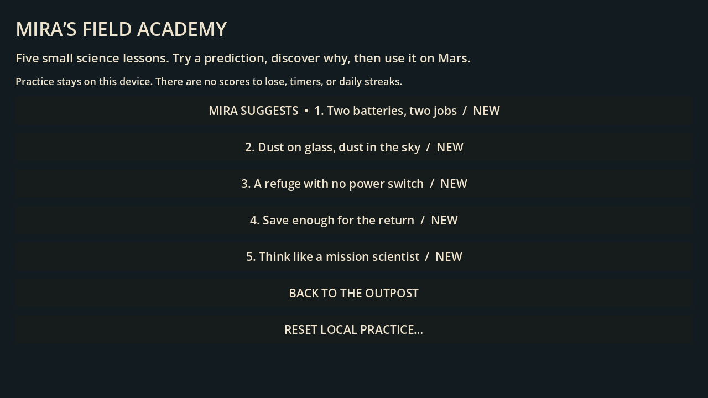

# Red Veil media gallery

These are captures of the **0.4.0-alpha.1 Web build**, exported from source `48901d0bce68e72974b36377c3a060f90403ebe9` and captured on November 14, 2026. They show the current mechanics alpha: provisional geometry, materials, characters, interface, and animation. They are actual game screens and keyboard/mouse gameplay, not concept art or generated promotional images.

## First-person gameplay


This 20-second recording (3.93 MiB) shows starting a mission, looking toward the solar array, walking, and switching on visor cleaning. It does not depict a completed mission or demonstrate educational effectiveness. The GIF has no audio. Its 960 × 540 resolution, 10 fps encoding, and software-rendered browser capture are presentation choices, not a game performance benchmark.


## Title and practice screens





The title and academy stills are 1280 × 720. The [capture manifest](media/red-veil-0.4.0-alpha.1-capture.json) records file hashes and provenance. Answer order is shuffled by the game, so a later capture may show a different order. The practice content is authored and the review estimates are provisional; see [learning design](LEARNING-DESIGN.md).

## Reproduce the captures

Use the matching versioned Web release, serve its extracted files over HTTP, and check its release manifest/source first. The capture command records the supplied version and commit; it does not independently authenticate those labels.

Prerequisites are the repository's pinned Playwright dependency, Chromium, system FFmpeg for GIF encoding, and Playwright's recorder binary:

```sh
npm ci
npx playwright install ffmpeg
python3 -m http.server 5192 --directory /path/to/extracted/Web
```

In a second terminal, from the repository:

```sh
node scripts/capture_game_media.mjs --url http://127.0.0.1:5192/ --version 0.4.0-alpha.1 --source 48901d0bce68e72974b36377c3a060f90403ebe9
```

On Linux the script uses `/usr/bin/chromium`; set `CHROMIUM_PATH` if your installed browser is elsewhere. It launches a fresh browser context, clicks the actual menus, sends ordinary keyboard/mouse input, and captures the canvas. It does not mutate the simulation, teleport the player, inject an update notification, hide errors, or paint features into the images. Startup/loading is trimmed from the GIF; normal color quantization is used to keep the file practical for GitHub. Raw recording and capture metadata go to `/tmp/red-veil-media-capture` by default; use `--raw` and `--output` to select other folders. The metadata records browser errors rather than silently discarding them.

The legacy `first-person-alpha.png` is an earlier historical capture and is not overwritten. New media uses explicit version filenames. Update documentation links when selecting newer release captures, and keep the depicted build's source and limitations visible.

## Scope and credits

These images do not establish native Mac/Windows compatibility, mobile usability, production update delivery, or final art quality. The Web update route differs from the signed native desktop route; no native-update popup has been fabricated for this gallery. Underlying scene/font/audio provenance remains in [credits](../CREDITS.md). The capture process adds no third-party concept artwork or new asset-license grant.

---

made with love by Team Roshan Xingbo at the NASA Space App Hackathon 2026, NYC
