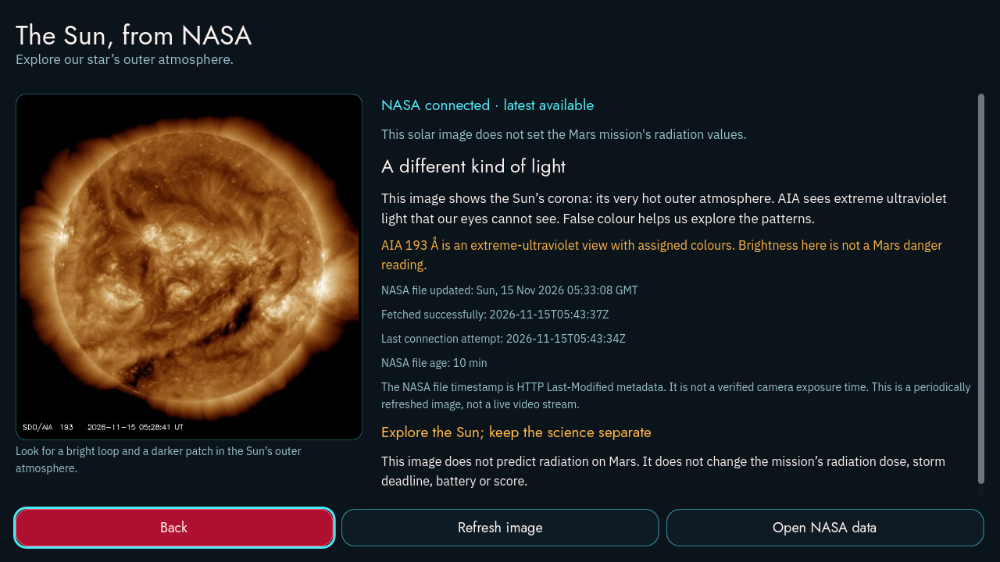
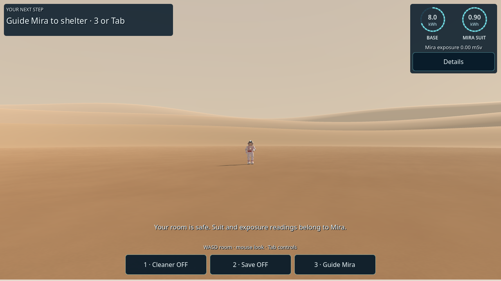
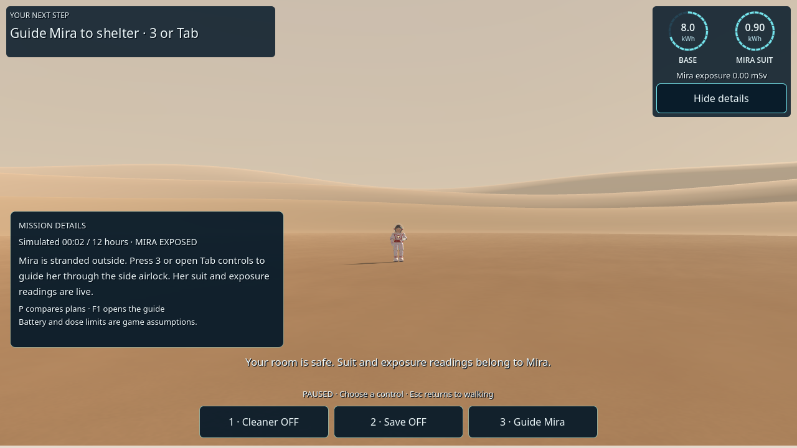
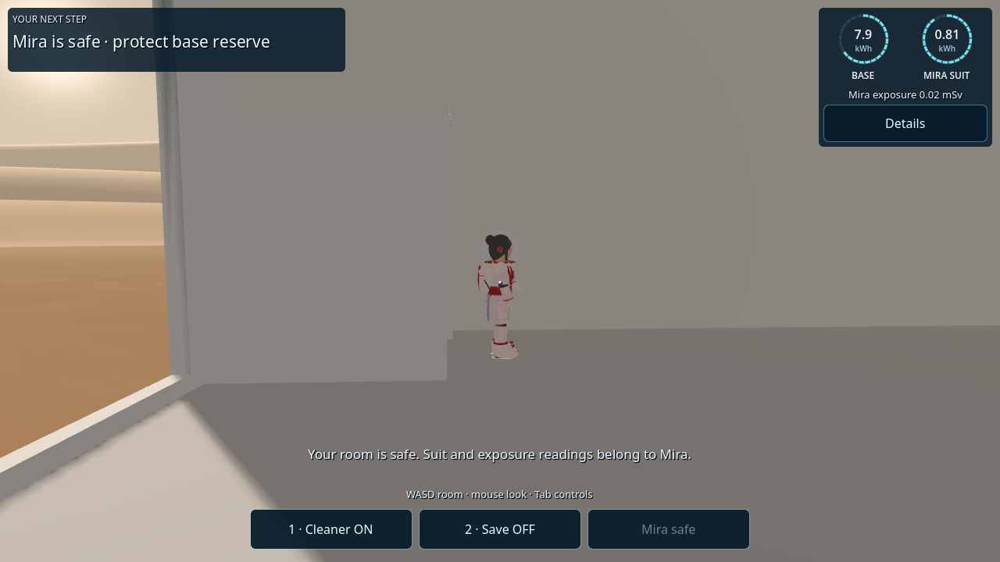
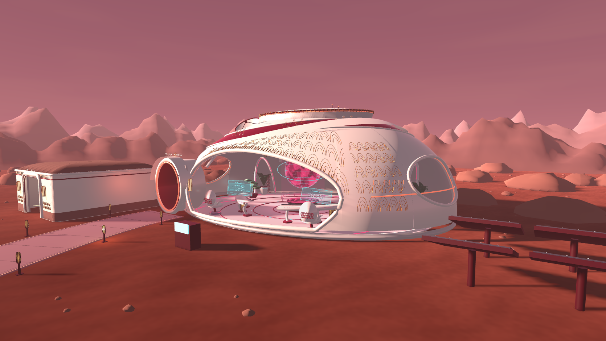
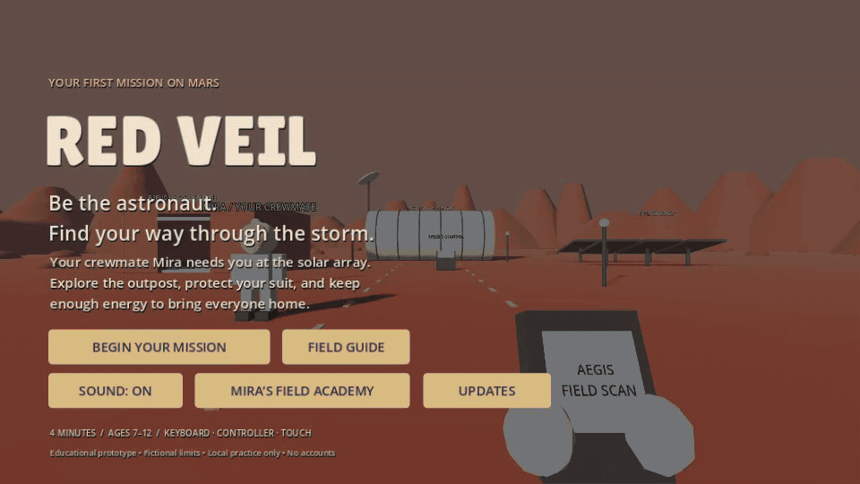

# <!-- brand:display_name -->KŌMAKU: Dust & Radiation<!-- /brand --> media gallery

## 0.10 candidate — a clearer window and optional discovery

The current view gives Ren's cleaning room to breathe: **panel cleaned, stored energy and remaining play time**, with one pace control. The eight-concept Science library pauses play; short cards offer **Learn more** and **Data & sources** separately. Real scene preparation can be cancelled to Home. The result leads to four brief science relationships, with exact equations and graphs available on request.


[Current native gallery](media/journey-0.10/README.md) · [Three readings and one pace control](media/journey-0.10/mission-desktop.png) · [Optional discovery library](media/journey-0.10/discovery-desktop.png) · [Four science relationships](media/journey-0.10/science-desktop.png) · [Source and fixture fingerprints](media/journey-0.10/capture-provenance.json).

The 135-state run covers five viewport sizes with zero geometry findings and 90 unchanged source fingerprints. These are native Linux/X11 software-rendered source captures. The NASA viewer uses an explicitly offline fixture; it is not a fresh observation. Layout acceptance does not establish downloaded-installer behavior, physical-device speed, device audio or child usability. [Validation](VALIDATION.md).

For a recording, start the 90-second standard round, capture the result, then choose **See how science connects**. Use **Explore my numbers and graphs** if the detailed equations are needed. [Recording guide](VIDEO-PITCH.md) · [Submission review draft](SUBMISSION-DRAFT.md).

## Historical 0.9 — closer work and a readable ending

The 0.9 source introduced a closer window view of Ren and the panel, larger bubbles/controls, a red pace slider, a 90-second primary countdown, three story scenes and a result-first equation reveal. The new native captures live separately under `docs/media/journey-0.9/`. Their provenance records the actual source and deterministic fixture; the screenshots are not proof of installer, updater or physical-device acceptance. The 0.8 files below remain unchanged historical evidence.


[Historical 0.9 gallery](media/journey-0.9/README.md) · [Actual cleaning animation](media/journey-0.9/cleaning-live.gif) · [Motion provenance](media/journey-0.9/CLEANING-CLIP.md) · [Bubble transition](media/journey-0.9/bubble-merge-desktop.png) · [Four equations](media/journey-0.9/science-desktop.png) · [Capture fingerprints](media/journey-0.9/capture-provenance.json).

The story illustrations are [generated, unlettered adaptations](../game/assets/art/journey/provenance.json) of the team's inline references, not exact source-image copies or 3D gameplay screenshots. Their exterior → astronaut → interior sequence is part of the opening; runtime text is rendered separately. The [original warning-cue provenance](../game/assets/audio/journey/cue-provenance.json) records the fallback used because the Drive beep was unavailable.

For recording the game, complete the short round, capture its result, then select **See how science connects**. Record the bubbles combining and the equation view; **Back to results** returns to the same run. The [video guide](VIDEO-PITCH.md) separates a full 90-second round from edited highlights for a 30-second pitch. [Submission text](SUBMISSION-DRAFT.md) remains a review draft.

## Historical 0.8 — cleaning, energy and the live Sun

These are actual native Godot source-project captures of the published 0.8 journey. The player sees Ren clean a visible solar array from inside the habitat, chooses a starting pace, and presses Start. Slower/Faster controls change modeled tiredness and effective work. The display shows actual stored energy; Ren enters shelter automatically when the countdown ends.


[Actual native cleaning animation](media/journey/cleaning-live.gif) · [Animation provenance](media/journey/CLEANING-CLIP.md)

[Full desktop/portrait screenshots and fixture method](media/journey/README.md) · [Source and image hashes](media/journey/capture-provenance.json)



[Live NASA capture scope](media/journey/LIVE-SUN.md) · [Exact response and source fingerprints](media/journey/live-sun-provenance.json). The entire NASA image, including its embedded observation label, is preserved. The viewer distinguishes the file-publication timestamp from the successful-fetch timestamp. The online image is an educational observation, not a measured dose at the fictional Mars habitat.

The reproducible general gallery disables networking, isolates player data and advances the actual model to documented fixture points. The live-NASA capture separately uses the actual HTTPS client with verified TLS. These are native Linux/X11 software-rendered source captures, not recordings from downloaded Mac/Windows installers, physical phones or a child usability study. A source fingerprint identifies the exact implementation; a later documentation commit does not change the depicted runtime. See [validation](VALIDATION.md) for independent numerical, interaction, network and release-artifact evidence.

## 0.7.1 — the same window view with deferred loading

Published [0.7.1-alpha.1](https://github.com/roshaninfordham/NASA-SPACE-APPS-HACKATHON-2026/releases/tag/v0.7.1-alpha.1) retains the indoor composition and rescue sequence. The capture below comes from the frozen runtime whose fingerprints match release source `c86ad73da7810176e437e33e192a8d8475ae72a8`.


This is an unedited 1280×720 source-project viewport captured with Godot 4.6.3, Xvfb and Mesa llvmpipe, with ambient time frozen for comparison. It is not an image of a downloaded installer or a physical-device performance test. [Capture hashes and numerical comparison](evidence/window-startup/candidate/comparison.json) record 52 changed pixels versus the earlier mission view; the framing is preserved, not asserted pixel-identical. [Returned title after Field Notes](evidence/window-startup/candidate/visual/field_notes_return.png) verifies restoration of the window camera. [Measurement method](WINDOW-STARTUP-PERFORMANCE.md) and [package verification](evidence/release-0.7.1-alpha.1.json) have separate scopes.

The 0.7 screenshots below remain historical input/rescue evidence. The 0.7.1 patch defers optional geometry and repairs the architecture lesson's camera restoration; it does not introduce a new visual direction. The 0.7.1 packaged guide refreshed source provenance without changing that historical model. The current guide explains the final pace-and-fatigue journey; the earlier model remains documented separately.

## Historical 0.7 release — indoor mission control

Actual, unedited Godot captures of the implemented **indoor operator rescue**. The default forward view contains dunes and Mira through the clear window, without the exterior dome, arrays, route props or room consoles in that frame. The operator stays inside and manages panel cleaning, base power and Mira’s return. The full source suite, 65 native input/capture assertions and 36 independent semantic assertions passed; the released Mac/Windows archives also passed hosted native launch gates. Physical-device acceptance remains separate.

**Published release: [v0.7.0-alpha.1](https://github.com/roshaninfordham/NASA-SPACE-APPS-HACKATHON-2026/releases/tag/v0.7.0-alpha.1), source `8968859e8ffdcda7b8c0c216ff0262df633400e6`.** The source-file hashes recorded for these captures match the release’s runtime files. These are source-project captures, not screenshots of a downloaded installer. [Release evidence](evidence/release-0.7.0-alpha.1.json).








The arrival image turns toward Mira after she enters. It is **behavior evidence, not the default camera view**. The capture compressed waiting through 39 ordinary controller calls of 0.25 seconds each; it did not assign character coordinates, rescue phases, shelter state or physics equations. The total mission time shown includes earlier interaction checks. It is not a real-time recording or a completed 12-hour mission image.

[Capture hashes, source fingerprints and input methodology](media/0.7-capture.json) identify these 1280×720 Godot 4.6.3 Linux GL/Xvfb/Mesa software renders. The PNGs were copied directly from the viewport without cropping, compositing or added overlays. Earlier outdoor-start images under these filenames were superseded and have now been replaced. These captures do not establish physical Mac/Windows/mobile performance, photoreal fidelity or learning outcomes.

Use the guide bundled with the corresponding historical release for those operator/EVA rules. The current [16-page science guide](media/KOMAKU-Science-Guide.pdf) covers the final pace mission; source-fingerprint checks guard against stale packaging.

The final landscape-only inventory falls from **109,710 to 21,388 retained triangles**; this is not a whole-game or FPS result. [Landscape scope](DESIGN-PIVOT-0.7.md). Earlier performance captures and their 33.7%/approximately 61% reductions are historical pre-pivot measurements. The former headless stone-placement digest was invalid and does not prove unchanged placements; [the corrected record](PERFORMANCE.md) explains why.

## Historical 0.6 — specification implementation

Actual Godot renders of the historical 0.6 visual-development alpha: a live Suit Lab, habitat lessons, expanded mission-control screens and ornamented architecture. These remain stylized procedural interpretations; they do not match the concept illustrations pixel for pixel. [Capture hashes and source provenance](media/komaku-0.6.0-alpha.1-capture.json).


[Wide control-room view](media/komaku-0.6.0-alpha.1-interior.png) · [Mira](media/komaku-0.6.0-alpha.1-astronaut.png) · [Title menu](media/komaku-0.6.0-alpha.1-title.png)

| Layout             | Suit Lab                                              | Habitat Field Notes                                      |
| ------------------ | ----------------------------------------------------- | -------------------------------------------------------- |
| Portrait, 390×844  | [View](media/komaku-0.6.0-alpha.1-suit-portrait.png)  | [View](media/komaku-0.6.0-alpha.1-habitat-portrait.png)  |
| Landscape, 844×390 | [View](media/komaku-0.6.0-alpha.1-suit-landscape.png) | [View](media/komaku-0.6.0-alpha.1-habitat-landscape.png) |

The six UI captures use source `0ae2bff760242437e85bd51fb5615c65fe5e7ed5` with a clean checkout. Release source `c0beba698c32741fb17f6c8e9ec44fd6bb875852` adds a title-menu height correction and its regression check; the depicted exhibit code is unchanged. World review cameras show the same 3D artwork from the preceding implementation commit; the manifest records that distinction and the close-view camera. All images come from Godot/Mesa software rendering. They are layout/design evidence, not physical-phone or frame-rate validation. Some callout anchors are obscured by the lesson card; the tabs remain available.

Reproduce the interface captures with `python3 scripts/capture_spec_review.py --output /tmp/komaku-review --xvfb /path/to/Xvfb`. The runner checks rendered lesson-card bounds and records hashes. To capture a fixed world view, use the Godot command in the historical section below.

## Historical 0.5 visual pass

These are actual Godot 4.6.3 renders of the **0.5.0-alpha.1** visual candidate, associated with release source `1b4d1b8e0907f76a055a8aca85e1073c4eff34eb`. They show original procedural interpretations of the design team's reference images. Final photoreal materials, character rigging and pixel-perfect likeness remain unfinished.

## Walk through the habitat


The 7.1-second GIF uses ordinary movement/look/visor input and a fixed-timestep recording. Its 960×540, 10fps encoding and software-rendered capture are presentation choices, not real-device frame-rate evidence. It has no audio and does not show a completed mission or rescue campaign.

## Environment and character




[First-person HUD](media/komaku-0.5.0-alpha.1-gameplay.png) · [Portrait layout](media/komaku-0.5.0-alpha.1-portrait.png)

The environment/character shots use repeatable review cameras; gameplay uses the normal player camera. The portrait image is a 390×844 desktop viewport, not physical-phone validation; the handheld scanner is partly clipped at narrow aspect. The [capture manifest](media/komaku-0.5.0-alpha.1-capture.json) records exact source distinctions, file hashes, input-driver code, rendering counts and limitations. These are source-project captures, not photographs or images of a downloaded native installer.

To reproduce a fixed view with an available graphics display:

```sh
godot --path game --script res://tests/capture_visuals.gd -- --view interior --output /tmp/komaku-interior.png
```

Other views: `exterior`, `astronaut`, `title`. Linux CI-style rendering can use an authenticated Xvfb display; software-renderer results do not establish physical GPU performance.

---

# Historical Red Veil 0.4 media

These are captures of the **0.4.0-alpha.1 Web build**, exported from source `48901d0bce68e72974b36377c3a060f90403ebe9` and captured on November 14, 2026. They show the historical mechanics alpha: provisional geometry, materials, characters, interface, and animation. They are actual game screens and keyboard/mouse gameplay, not concept art or generated promotional images.

## First-person gameplay



This 20-second recording (3.93 MiB) shows starting a mission, looking toward the solar array, walking, and switching on visor cleaning. It does not depict a completed mission or demonstrate educational effectiveness. The GIF has no audio. Its 960 × 540 resolution, 10 fps encoding, and software-rendered browser capture are presentation choices, not a game performance benchmark.


## Title and practice screens


The title and academy stills are 1280 × 720. The [capture manifest](media/red-veil-0.4.0-alpha.1-capture.json) records file hashes and provenance. Answer order is shuffled by the game, so a later capture may show a different order. The practice content is authored and the review estimates are provisional; see [learning design](LEARNING-DESIGN.md).

## Reproduce the captures

Use the matching versioned Web release, serve its extracted files over HTTP, and check its release manifest/source first. The capture command records the supplied version and commit; it does not independently authenticate those labels.

Prerequisites are the repository's pinned Playwright dependency, Chromium, system FFmpeg for GIF encoding, and Playwright's recorder binary:

```sh
npm ci
npx playwright install ffmpeg
python3 -m http.server 5192 --directory /path/to/extracted/Web
```

In a second terminal, from the repository:

```sh
node scripts/capture_game_media.mjs --url http://127.0.0.1:5192/ --version 0.4.0-alpha.1 --source 48901d0bce68e72974b36377c3a060f90403ebe9
```

On Linux the script uses `/usr/bin/chromium`; set `CHROMIUM_PATH` if your installed browser is elsewhere. It launches a fresh browser context, clicks the actual menus, sends ordinary keyboard/mouse input, and captures the canvas. It does not mutate the simulation, teleport the player, inject an update notification, hide errors, or paint features into the images. Startup/loading is trimmed from the GIF; normal color quantization is used to keep the file practical for GitHub. Raw recording and capture metadata go to `/tmp/red-veil-media-capture` by default; use `--raw` and `--output` to select other folders. The metadata records browser errors rather than silently discarding them.

The legacy `first-person-alpha.png` is an earlier historical capture and is not overwritten. New media uses explicit version filenames. Update documentation links when selecting newer release captures, and keep the depicted build's source and limitations visible.

## Scope and credits

These images do not establish native Mac/Windows compatibility, mobile usability, production update delivery, or final art quality. The Web update route differs from the signed native desktop route; no native-update popup has been fabricated for this gallery. Underlying scene/font/audio provenance remains in [credits](../CREDITS.md). The capture process adds no third-party concept artwork or new asset-license grant.

---

made with love by Team Roshan Xingbo at the NASA Space App Hackathon 2026, NYC
