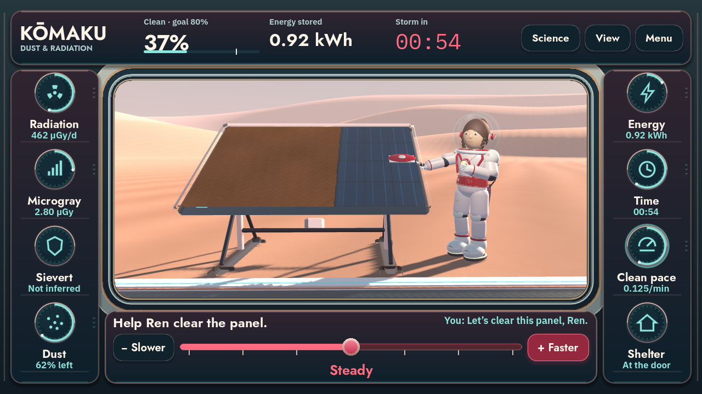

# Offline play and device-aware presentation

November 15, 2026 · **Unreleased source milestone.** Published downloads still contain 0.10. This work does not constitute a new installer, a photorealistic remake, or a verified mobile release.



## What works now

The outpost window, Ren's visible brushing, changing panel dust, eight science bubbles, pace control, results and saved training history remain the core experience. Rendering choices never change the mission equations, outcome thresholds or learning records.

| Change                                 | Player experience                                                                                                                                                                  |
| -------------------------------------- | ---------------------------------------------------------------------------------------------------------------------------------------------------------------------------------- |
| Auto / Battery saver / Balanced / High | Settings saves a graphics preference independently of progress; Auto starts conservatively, and the player can override it.                                                        |
| Offline by default                     | The mission, bundled science, coach and local progress need no account, API key or network. Settings can enable optional NASA imagery and update checks.                           |
| Source-based mission coach             | Open a science bubble, then **Mission coach · offline** for a prediction question about the current concept; **Check the explanation** reveals the reasoning. Reading pauses play. |
| Presentation polish                    | Braced cleaning animation, filtered panel dust, closer shadow coverage, reduced terrain shadow artifacts, calmer window trim and clearer control states.                           |
| Narrow-screen Settings                 | Short labels and wrapping notes avoid the overflowing connection control found during visual checks.                                                                               |

The coach is authored contextual logic, **not neural inference**. It distinguishes power from stored energy, dose rate from accumulated dose, and microgray from sievert. No personal health data is collected or inferred. The existing journal records attempts and practice answers; opening a bubble does not prove mastery.

## What the graphics flags actually do

| Preset        | Frame cap | Antialiasing | Directional shadows | Decorative dust                      |
| ------------- | --------- | ------------ | ------------------- | ------------------------------------ |
| Battery saver | 30 FPS    | Off          | Off                 | Off                                  |
| Balanced      | 60 FPS    | 2× MSAA      | Art-profile setting | Half the art-profile particle budget |
| High          | 60 FPS    | 4× MSAA      | Art-profile setting | Full art-profile particle budget     |

These are caps and settings, **not measured achieved frame rates**. The UI remains at its native viewport resolution. Reduced motion disables decorative dust at every quality level. The modeled dust covering the panel remains visible and scientifically identical at every level.

Auto selects Battery saver for mobile/web, unknown or at-most-8-GiB memory, unknown adapters and recognized software renderers; otherwise it starts Balanced. RAM and platform are conservative hints, not a GPU benchmark. Auto does not select High, download assets, load a model or switch renderers. Dynamic profiling and physical-device qualification remain future work.

Preferences live in `user://graphics-settings.cfg` and `user://connection-settings.cfg`; existing mission progress/save identity remains unchanged. The `--offline` launch argument locks optional game HTTP requests off for the session. Source hyperlinks still open the system browser only when explicitly selected; those websites require connectivity. Enabling online sources permits normal update/imagery checks; offline mode cannot discover newly published releases.

## Storage and optional components

Development, captures and model evaluation for this milestone run in the cloud workspace. They do not fill the user's laptop. Downloaded installers, installed assets, saves and any optional local model necessarily consume storage on the device where the game runs.

The selected product direction is a **complete small base game**, with separately chosen richer art, voice and local-model packs. The base already runs without model weights. A pack-selection installer, verified pack activation/removal, and optional inference inside the game are **not implemented by this milestone**. [Full modular roadmap and engine/model review](OFFLINE-POLISH-ROADMAP.md).

Per-child model training is unnecessary for the current adaptation: local practice history can select the next concept or hint, while one shared optional model can rephrase approved facts. Do not claim that the prototype has demonstrated long-term learning gains or a validated adaptive curriculum.

An actual [Qwen3-1.7B / llama.cpp experiment](LOCAL-MODEL-EVALUATION.md) ran in the cloud with verified public weights: 11 initial cases plus six stricter repeats. Local inference worked, but incorrect science and some responses over the proposed 12-second limit prevented approval. The reports and reproduction harness are in the repository; model/runtime files remain outside it. No neural model is silently substituted for the game's accurate source-based explanations.

## Review and reproduce

[Mission](media/offline-polish/mission-desktop.png) · [Coach on desktop](media/offline-polish/coach-desktop.png) · [Coach on portrait](media/offline-polish/coach-mobile.png) · [Settings](media/offline-polish/offline-settings.png) · [Capture hashes](media/offline-polish/provenance.json).

The five focused images are actual Godot/Compatibility renders with a fixed Balanced preset and a deterministic 36-second model fixture. They are not retouched concept images, human playtests, or performance measurements. The separate whole-journey capture checks five viewport sizes; [validation](VALIDATION.md) records its outcome and the shared suite result.

```sh
python3 scripts/test_game.py
python3 scripts/capture_offline_polish.py --xvfb /path/to/Xvfb
godot --path game -- --offline
```

Use Godot 4.6.3; the full test runner uses isolated Linux player profiles. Capturing additionally requires Xvfb. No model is required for these commands.

The next substantial fidelity step is authored character/hand animation, materials and close-up assets, followed by real-device profiling. Keeping Godot preserves the working mission, accessibility and updater architecture; changing engines alone would not supply those assets. Native package, signing and update acceptance must be repeated on the final release bytes before a new download is advertised.

Made with love by Team Roshan Xingbo at the NASA Space App Hackathon 2026, NYC.
