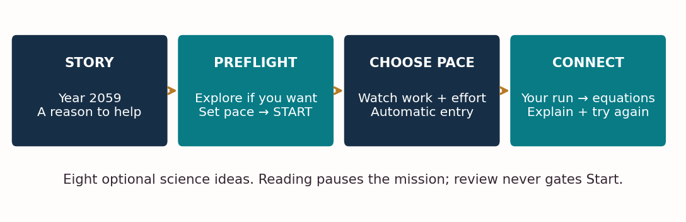
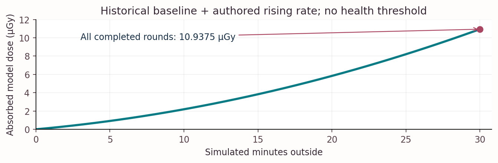
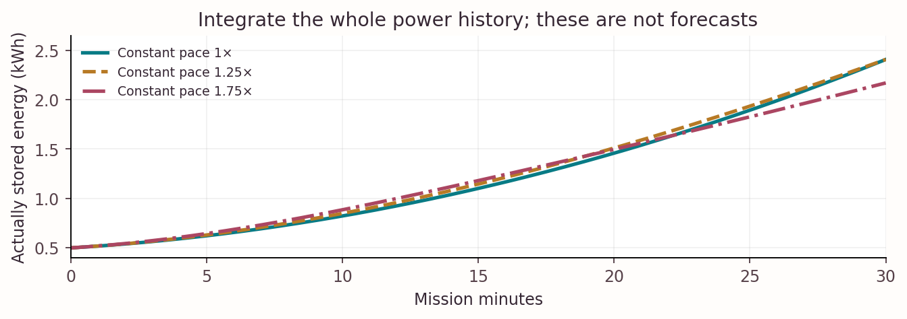
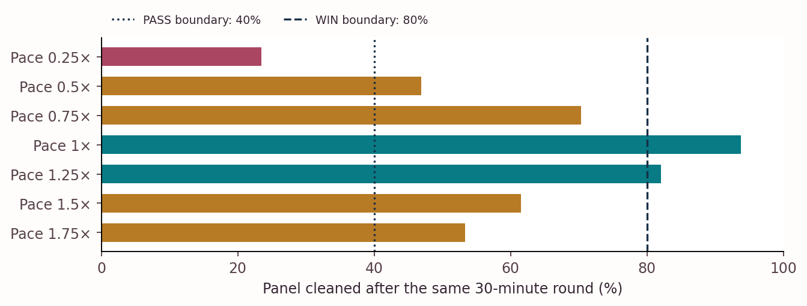

# <!-- brand:display_name -->KŌMAKU: Dust & Radiation<!-- /brand --> — the science inside the game

Readable source for [the illustrated PDF](media/KOMAKU-Science-Guide.pdf). This edition explains only the **current pace/fatigue workflow**. Reviewed November 15, 2026, America/New_York. Build: `python3 scripts/build_science_guide.py`. Historical recall/forecast and advanced EVA models are documented separately; their rules do not belong to this mission.

## 01 · One small mission, connected ideas

### Dust Off the Solar Panel — Power Up the Outpost

It is the year 2059 in our story. You are inside a Mars habitat, looking across the dunes. Ren is outside beside a dusty solar panel and the shelter entrance. Your job is to choose a working pace and discover how work, sunlight, stored energy, and radiation dose connect. The intended learners are ages 7–12, with optional detail for curious readers.

The story leads directly to the control room in **preflight**. Inspect concepts or set a starting pace if you want; nothing advances until **START MISSION**. Three main readings show cleaning, stored energy, and time. The eight ideas live in optional **Science**, not a reading gate. The round lasts 30 simulated minutes, normally **90 active real seconds at ×20**. Reading and pauses add no mission time.



Ren cleans automatically once the round starts. SLOWER, FASTER, and a stepped slider change the requested pace. An authored effort mechanic can reduce the effective rate. At zero, Ren enters shelter automatically: there is no recall choice, return walk, or extra entry minute. The result uses the player's actual run.

### Read at two levels

**Start simple:** read the opening idea, picture, and example. **Go deeper:** inspect the equations, units, assumptions, source links, and code paths. Every number should be a cited observation, a mathematical consequence, or a clearly chosen mission setting.

This guide explains an educational model. It does not certify spacecraft, real astronaut physiology, clinical decisions, professional training, or learning effectiveness. The live NASA image is an observation to explore, not a numerical Mars forecast.

## 02 · Eight ideas, available when needed

### Explore the vocabulary without blocking play

Open **Science** to choose one of eight ideas. Each card starts with a brief explanation, diagram, and everyday analogy. **Learn more** reveals fuller reasoning and equations. **Data & sources** separates real evidence from game settings and opens cited sources in the device's browser when connected.

| Concept   | The idea to take away                                                                                  |
| --------- | ------------------------------------------------------------------------------------------------------ |
| Radiation | Radiation rate describes energy deposition per mass per time. Visible dust is not a radiation meter.   |
| Dose: µGy | Absorbed dose accumulates over outside time. It is not a health bar.                                   |
| Sievert   | Weighted radiation quantities require additional information; the game does not calculate personal Sv. |
| Dust      | A cleaner panel can transmit more useful sunlight.                                                     |
| Energy    | Solar generation minus habitat load changes stored battery energy.                                     |
| Time      | One simulated countdown drives the round; pauses freeze it.                                            |
| Pace      | Requested multiplier differs from effective cleaning rate when fictional effort builds.                |
| Shelter   | Ren enters automatically at zero; there is no physical route or distance calculation.                  |

The optional review record means **concepts explored**, not mastery. Opening a card does not prove understanding. The library shows no readiness percentage or reading-completion gate. Reading during play must pause the same model that handles work, effort, energy, and dose.

The debrief reconnects ideas using the current run's values. A low-stakes reflection can invite an explanation; it cannot certify ability from a single answer. A result below the target is an invitation to try another plan, not punishment for reading slowly or needing a hint.

**Trace:** `game/data/mission-concepts.json`, the shared journey interface, and the final workflow contract. Local text works offline; opening external evidence requires connectivity.

## 03 · Observations and chosen mission settings

### NASA supports evidence and mechanisms, not every number

| Item                     | Evidence or setting                                                     | What we can say                                                             |
| ------------------------ | ----------------------------------------------------------------------- | --------------------------------------------------------------------------- |
| 210 ± 40 µGy/day         | Historical RAD E-detector result, Gale Crater, 2012–2013 [S1]           | Baseline reference, not today's weather or Ren's measured body dose.        |
| 0.28% per day            | Pathfinder short-circuit-current decrease reported in a NASA paper [S3] | Dust reduced current in that experiment; this is not a runtime coefficient. |
| 0.25–1.75× pace          | Seven authored multiplier choices                                       | A work-rate control, not walking speed or fitness.                          |
| Effort growth / recovery | Authored coefficients 0.08 / 0.12 per mission minute                    | A fictional slowdown mechanic, not validated physiology.                    |
| 8 kW panel / 1 kW load   | Fictional hardware values                                               | Inputs to an ideal energy balance, not NASA habitat specifications.         |
| 0.5 / 6 kWh              | Starting battery / capacity                                             | Stored energy, distinct from power.                                         |
| 30-minute round          | Story and task duration                                                 | Automatic shelter entry, not guaranteed real storm warning.                 |
| Fourfold radiation ramp  | Authored linear rise over the round                                     | Not measured by NASA or derived from the live solar image.                  |
| 40% / 80% clean          | PASS / WIN boundaries                                                   | Game goals, not engineering or medical safety limits.                       |

The absorbed-dose reference comes from the primary paper: **0.21 ± 0.04 mGy/day**, equivalent to **210 ± 40 µGy/day**, in RAD's tissue-like E detector. Measurements cover approximately the first 300 sols, August 7, 2012–June 1, 2013, near solar maximum [S1]. The engine uses the central value; it does not replay a time series or sample the uncertainty.

**Trace:** `pace_mission.gd: DEFAULTS` and `docs/SCIENCE-JOURNEY-SOURCES.md`. The model and guide reject changed constants that would silently invalidate worked examples.

## 04 · Radiation rate and accumulated dose

### A historical baseline plus an explicitly fictional ramp

One gray is one joule of absorbed energy per kilogram. One microgray, **µGy**, is one millionth of a gray [S2]. A rate tells how quickly dose accumulates; dose tells the accumulated amount. Use **t in simulated minutes**, T = 30, and a 24-hour Earth day of 1,440 minutes.

```text
Rate r(t) = 210 × [1 + 3t/30]                 µGy/day
Dose D(t) = (1/1440) ∫₀ᵗ r(s) ds             µGy
          = (210/1440)[t + 3t²/(2 × 30)]      µGy
At 30 minutes: D = 10.9375 µGy
```



The curve starts at the historical central reference and ends at 840 µGy/day. The **linear rise and fourfold endpoint are invented mission settings**. They are not a measured solar storm, a validated forecast, or a value read from NASA's live solar image.

Every completed round uses the same 30-minute outside duration and rate curve, so every completed round has the same **10.9375 µGy** model dose. Cleaning pace cannot earn a lower-dose bonus. Pauses freeze time; they neither add dose nor recover effort. Automatic entry ends this activity's outside-dose record; it does not mean radiation inside is zero.

No dose here is labelled as a lethal threshold or a personal clinical measurement. The distinction between gray and sievert is explained on page 13.

## 05 · Requested pace is not effective rate

### A fictional effort mechanic makes choices matter

The player selects a unitless pace multiplier **u**: 0.25, 0.50, 0.75, 1.00, 1.25, 1.50, or 1.75. The effort state **F** starts at zero and stays between zero and 0.9. These are authored task-balancing choices, not measured astronaut performance.

Let **a = 1 during active cleaning**, otherwise zero. Active cleaning requires Start, unpaused play, time remaining, and work below the four-section cap. A section is one quarter of the fictional task, not a measured square metre.

```text
dF/dt = a[0.08 max(u − 1, 0) − 0.12 max(1 − u, 0)]
F is bounded to 0…0.9; t is in mission minutes
Effective rate q = 0.125 × a × u × (1 − F)    sections/min
Work W(t) = min[4, ∫₀ᵗ q(s) ds]              sections
Clean fraction C = W/4; dust task index = 1 − C
```

Above pace 1, effort builds. Below 1, it recovers. At exactly 1, **existing effort stays unchanged**; normal pace does not automatically erase it. At pace 1.5 and F = 0.6, effective rate is `0.125 × 1.5 × 0.4 = 0.075 sections/min`, less than the unfatigued base rate.

When four sections are complete, work and F freeze. Solar generation, stored energy, and outside dose continue until the deadline. The result must integrate the actual intervals; final rate multiplied by total time is usually wrong.

This model does not infer fatigue from dose, heart rate, age, or a smartwatch. It does not tell a real astronaut or child how hard to work. The lesson is about a disclosed game rule and the difference between a requested setting and effective output.

## 06 · Power flows; energy is stored

### Cleaning changes generation, and generation charges the battery

The clean-panel rating is 8 kW. Authored transmission is `0.25 + 0.75C`, where C is the clean fraction. The initially dusty panel therefore supplies 2 kW; a fully clean panel supplies 8 kW. “100% task dust remaining” does not mean zero light transmission.

```text
Solar power P(t) = 8 × [0.25 + 0.75C(t)]       kW
Net power = P(t) − 1 kW habitat load
Energy E(t) = 0.5 + (1/60) ∫₀ᵗ [P(s) − 1] ds kWh
Battery energy stays between 0 and 6 kWh
```



The factor 1/60 converts simulated minutes into hours. The default panel always supplies more than the 1 kW load, so this round charges the battery. Real storage also needs efficiency, temperature, voltage/current limits, ageing, and hardware validation.

**These are actual energy histories, not forecasts.** The earlier 2 kWh projected-at-warning reserve criterion is not part of this workflow. Paces 1 and 1.25 happen to end with the same stored energy even though they finish with different clean fractions: earlier generation and later slowdown compensate. Final power alone does not reveal the full energy history.

## 07 · Same duration, different cleaning outcomes

### Compare stated choices without claiming an optimal strategy

These independent examples hold each requested pace constant for the full round, beginning with F = 0. They are checked comparisons, not prerecorded player results or a proof of the best mixed-pace strategy.



| Constant pace | Clean panel / actual energy | Outcome |
| ------------- | --------------------------- | ------- |
| 0.25×         | 23.4375% / 1.3515625 kWh    | LOSE    |
| 0.50×         | 46.8750% / 1.7031250 kWh    | PASS    |
| 0.75×         | 70.3125% / 2.0546875 kWh    | PASS    |
| 1.00×         | 93.7500% / 2.4062500 kWh    | WIN     |
| 1.25×         | 82.0313% / 2.4062500 kWh    | WIN     |
| 1.50×         | 61.5234% / 2.2788086 kWh    | PASS    |
| 1.75×         | 53.3203% / 2.1689453 kWh    | PASS    |

The exact outcome bands are **WIN: C ≥ 0.8; PASS: 0.4 ≤ C < 0.8; LOSE: C < 0.4**. Ren enters shelter in every category. Energy and dose explain the run; neither is a hidden additional win condition.

All rows have the same **10.9375 µGy** model dose. The chart describes this authored task, not a universal speed-versus-health law. Mixed-pace runs need their own recorded history.

## 08 · Connect the bubbles to your own result

### Four main groups, with effort underneath cleaning

The reveal explains the actual run in four short visual relationships. **Explore my numbers and graphs** opens the full equations and histories; the player can return to the result without opening that detail. The [separate video equation sheet](https://github.com/roshaninfordham/NASA-SPACE-APPS-HACKATHON-2026/blob/main/docs/VIDEO-EQUATIONS.md) provides the animation handoff.

| Group                    | Child-facing connection                                      | Numerical meaning                                     |
| ------------------------ | ------------------------------------------------------------ | ----------------------------------------------------- |
| Pace + effort + time     | “Your pace and effort decide how much gets cleaned.”         | Integrate effective cleaning rate to obtain work.     |
| Cleaner panel            | “Less dust lets more useful sunlight through.”               | Clear-panel rating × authored transmission gives kW.  |
| Stored energy            | “Energy left after the habitat's needs charges the battery.” | Integrate generation minus load to obtain kWh.        |
| Radiation + outside time | “Dose adds up while Ren is outside.”                         | Integrate the authored dose-rate curve to obtain µGy. |

### Example: normal pace throughout

At u = 1, F stays zero. After 30 minutes, `W = 0.125 × 30 = 3.75` sections. The panel is 93.75% clean with 6.25% task dust remaining. Final power is `8 × (0.25 + 0.75 × 0.9375) = 7.625 kW`.

```text
Average power = (2 + 7.625)/2 = 4.8125 kW
Actual energy = 0.5 + (4.8125 − 1) × (30/60)
              = 2.40625 kWh
Dose = 10.9375 µGy; result = WIN
```

This average-power shortcut works for this particular linear-power example. It does not replace integration for arbitrary fatigue or pace changes. Use the player's actual final values and histories; do not present this example as everyone's run.

Sievert remains a separate explanation, not a computed health number. Shelter marks automatic completion. A warning bar represents fictional countdown progress, not measured storm distance.

## 09 · Under the hood: exact interval arithmetic

### Changing effort makes power quadratic, not linear

The authoritative rules are in `game/scripts/pace_mission.gd`. The interface advances them only during active play. New visuals must not create a second clock or silently change units.

For one constant-pace active interval of Δ minutes, let initial effort be F₀, initial work W₀, `A = 0.125u`, and `g = 0.08 max(u−1,0) − 0.12 max(1−u,0)`. Without crossing a bound:

```text
F(s) = F₀ + gs
q(s) = A(1 − F₀ − gs)
ΔW = A[(1 − F₀)Δ − gΔ²/2]
∫ W(s) ds = W₀Δ + A[(1 − F₀)Δ²/2 − gΔ³/6]
ΔE = [(2 − 1)Δ + 1.5 ∫ W(s) ds] / 60   kWh
```

Fatigue is linear, rate is linear, work and power are quadratic, and energy is cubic within such an interval. **A trapezoid using only start/end power is not exact for quadratic power.** That shortcut belonged to the superseded constant-rate recall model.

Split the calculation at pace changes, fatigue bounds, work completion, storage bounds, and the deadline. At a fatigue bound, outward growth/recovery is clipped; at full work, cleaning and effort stop. At battery capacity, extra energy must be accounted for rather than silently created or destroyed.

The radiation integral is exact across an interval from t₀ to t₁: `(210/1440)[(t₁−t₀) + 3(t₁²−t₀²)/(2×30)]`. Splitting the same elapsed time into smaller frames should not change the answer beyond numerical tolerance.

Tests can verify arithmetic and state transitions. They do not validate real spacecraft hardware, astronaut performance, or learning efficacy.

## 10 · Learning support without a secret score

### Exploring, understanding, and remembering are different

The story leads to preflight, where the player may start immediately or choose **Explore science** first. The optional library remains available. Stored review history records exploration, not intelligence, readiness for a real mission, or mastery; the interface does not display a readiness score.

Use short analogies to introduce each quantity. Follow with the scientific fact, its source, and the separate mission assumption. At the end, reconnect the player's choices to their recorded result and invite an explanation.

| Prompt                                                         | What it can reveal                                                       |
| -------------------------------------------------------------- | ------------------------------------------------------------------------ |
| “Why can the fastest setting finish less work?”                | Requested pace differs from effective rate in the authored effort model. |
| “Does normal pace erase effort already built up?”              | At u = 1, the current F stays unchanged.                                 |
| “Why can two different clean fractions store the same energy?” | Energy depends on the whole generation history, not only final power.    |
| “Why is everyone's final dose the same?”                       | The completed-round duration and radiation curve are fixed.              |
| “Does reviewing a card prove I understand?”                    | Exploration is useful, but not a validated assessment.                   |

### Accessible and local by design

Reading and Pause freeze the whole simulation. Sound should support the atmosphere without being required to understand a warning. Reduced motion must preserve instructions and outcomes. Keyboard, touch, pointer, focus, and fullscreen paths need actual device checks.

This is not a reflex contest, clinical assessment, trained AI tutor, or proven curriculum. Learning research informs the design, but effectiveness still requires supervised usability sessions, concept checks, delayed recall, and comparison with suitable alternatives. Local preferences and limited learning records do not need names, health data, accounts, or cloud inference.

## 11 · Real observations, clear model boundaries

### A useful lesson also says what it cannot calculate

Real radiation depends on particle species and energy, the solar cycle, atmosphere, secondary particles, and shielding geometry/materials. Curiosity measured about **4% less overall radiation** beside Murray Buttes in September 2016 [S6]. That observation does not certify this game's dome.

NASA reported an **8,100 µGy** event dose during the May 2024 solar storm [S7]. It demonstrates variability; it does not supply our linear fourfold ramp or exact 30-minute warning. Real solar-particle events are not a smooth universal countdown curve.

| Not established by this game | What stronger modelling requires                                                               |
| ---------------------------- | ---------------------------------------------------------------------------------------------- |
| Actual human dose or health  | Appropriate dosimetry, radiation transport, qualified analysis; not heart rate or step counts. |
| Hardware-grade storage       | Efficiency, temperature, current/voltage limits, degradation, and validation.                  |
| Real dust removal            | Measured deposition/removal, geometry, light, materials, and electrical response.              |
| Astronaut fatigue            | Validated human/task/suit data; not invented pace coefficients.                                |
| Educational effectiveness    | Defined objectives and evaluated learning, retention, transfer, and accessibility.             |

### A live view of the Sun is a different observation

The optional solar view requests NASA SDO's latest available AIA 193 Å extreme-ultraviolet browse image [S9]. Online, stale, cached, and bundled fallback states are distinct. File age over 24 hours receives a stale label by our authored policy.

Retrieval time, cached-copy age, and server file metadata do not verify exposure time or guarantee freshness. The bundled example is never labelled live. This image is for exploration, not a Mars dosimeter or storm predictor. It does not change fatigue, dose, power, deadlines, or outcomes.

## 12 · Evidence you can open

### Primary sources and their actual roles

**[S1] Historical absorbed-dose baseline.** Hassler et al., _Science_ 343, 1244797 (2014). [NASA archive](https://ntrs.nasa.gov/citations/20180007641); [primary author manuscript at Caltech](https://authors.library.caltech.edu/records/kdt88-3aw98). Table 1 reports 0.21 ± 0.04 mGy/day in the tissue-like E detector. The approximate 300-sol observation interval is distinct from the per-day rate denominator. The game uses a 24-hour Earth day.

**[S2] Radiation quantities.** [US EPA: Radiation Terms and Units](https://www.epa.gov/radiation/radiation-terms-and-units). Gray is absorbed energy per mass. Weighted radiation quantities require additional information; our µGy counter does not determine individual health.

**[S3] Dust experiment.** [NASA: A Dust Characterization Experiment for Solar Cells Operating on Mars](https://ntrs.nasa.gov/citations/20020031145). Reports Pathfinder's 0.28% per day decrease in short-circuit current. This is source context, not a coefficient in the cleaning, fatigue, or energy equations.

**[S4] Power engineering.** [NASA: Power Operations of the Mars Exploration Rovers](https://ntrs.nasa.gov/citations/20230007029). Describes solar arrays, batteries, loads, and multiple environmental factors. It does not validate fictional habitat hardware.

**[S5] Time and environment.** [NASA Science: Mars Facts](https://science.nasa.gov/mars/facts/). A sol is approximately 24.6 Earth hours. The mission explicitly converts minutes using an Earth day, not a sol.

**[S6] Natural shielding.** [NASA/JPL: How Curiosity is making Mars safer for astronauts](https://www.nasa.gov/centers-and-facilities/jpl/how-nasas-curiosity-rover-is-making-mars-safer-for-astronauts/). Reports the Murray Buttes observations; no universal shelter factor is calculated in this mission.

**[S7] Variable space weather.** [NASA: Mars during the May 2024 solar storm](https://www.nasa.gov/solar-system/planets/mars/nasa-watches-mars-light-up-during-epic-solar-storm/). Observed event dose is not this game's authored rate curve or a clinical threshold.

**[S8] Different radiation summary.** [NASA's 2013 Curiosity results](https://www.nasa.gov/news-release/nasa-rover-results-include-first-age-measurement-on-mars-and-help-for-human-exploration/) reports 0.67 mSv/day dose equivalent. It is not interchangeable with the absorbed-dose baseline and is not used numerically in the final workflow.

**[S9] Live solar imagery.** [NASA SDO: The Sun Now](https://sdo.gsfc.nasa.gov/data/); [data-use rules](https://sdo.gsfc.nasa.gov/data/rules.php). Credit: **Courtesy of NASA/SDO and the AIA, EVE, and HMI science teams.** Browse images are educational observations; scientific analysis/publication requires PI consent under the source's rules.

Complete source roles, learning papers, and retained legacy references are in `docs/SOURCE-INDEX.md`. Data and scenario assumptions are separated in `docs/SCIENCE-JOURNEY-SOURCES.md`. PDF generation is offline and bundles no third-party research paper.

## 13 · Why sievert is not another health meter

### Related units can describe different quantities

Absorbed dose measures energy deposited per mass: **1 Gy = 1 J/kg**. One µGy is 10⁻⁶ Gy. A numerical conversion between µGy and Gy changes the scale of the same quantity; it does not create a weighted dose or a health prediction.

Equivalent and effective dose incorporate radiation/tissue information. As conceptual definitions, not calculations performed by this game:

```text
Equivalent dose: H_T = Σ_R w_R × D_(T,R)      Sv
Effective dose:  E_eff = Σ_T w_T × H_T         Sv
```

Here D\_(T,R) is absorbed dose in Gy to a specified tissue T from radiation type R. The appropriate radiation weights w_R and tissue weights w_T require information this aggregate detector-derived counter does not supply. E_eff is a radiation quantity, entirely separate from battery energy E.

The primary RAD paper reports **0.64 ± 0.12 mSv/day** as a dose-equivalent result [S1]. NASA's news summary reports 0.67 mSv/day [S8]. Neither is a general conversion factor from the game's µGy count. Mixing the two because both describe radiation would change the physical quantity without evidence.

### A better bubble explanation

“Sievert needs more information than our dose counter gives.” Show a concept explanation and source, not a numeric body-risk bar. Do not animate µGy = Sv or interpret the final 10.9375 µGy as a diagnosis, injury threshold, or exposure recommendation.

Ordinary smartwatch heart rate, steps, or health readings do not measure ionizing-radiation dose. This game collects no wearable data and makes no clinical inference. The fictional effort state is another separate quantity: it is controlled by authored pace rules, not dose or biological measurements.

## 14 · Bounds, pauses, and numerical consistency

### Limits are part of the mathematics

The model uses one simulated clock, with explicit state boundaries. These boundaries must be handled consistently when a frame is long, a slider changes pace, a concept opens, or the task finishes early.

| Boundary               | Required behavior                                                                                    |
| ---------------------- | ---------------------------------------------------------------------------------------------------- |
| Preflight              | Choosing pace changes the starting choice, not work, fatigue, energy, dose, or time.                 |
| Reading / Pause        | Freeze the whole simulation; no free effort recovery or stored work.                                 |
| F = 0 or 0.9           | Split at the bound; do not integrate beyond it and clip only after a long frame.                     |
| Four sections complete | Stop cleaning and fatigue change; keep power, energy, time, and dose advancing.                      |
| Empty/full battery     | Bound storage and account for unserved demand or curtailed surplus where applicable.                 |
| T = 30 minutes         | Stop exactly at the deadline, enter shelter automatically, and classify the recorded clean fraction. |
| Finished round         | Further calls must not add time, work, energy, or dose.                                              |

At pace 1.5, effort reaches its 0.9 cap after 22.5 minutes. At pace 1.75, it reaches the cap after 15 minutes. The remaining interval must use that bounded value; extending the initial linear expression across the whole round would produce incorrect work and energy.

The guide's seven constant-pace examples use independent analytic solutions and are checked against the engine. More tests cover mixed pace, boundary crossing, frame partitioning, and equal completed-round dose. These checks provide evidence about this software's arithmetic, not physiological or engineering validation.

Replaying a stored summary must preserve its model/version identity. Older walking or recall answers cannot be silently relabelled as evidence about the new effort mechanic.

## 15 · What changed in the final workflow

### Keep the latest experience internally consistent

The supplied November 15 workflow simplifies the game around one visible panel, one pace control, and one fixed countdown. Some original labels and proposed rewards required correction so the educational explanation remains true.

| Reference or earlier rule                  | Final workflow                                                                |
| ------------------------------------------ | ----------------------------------------------------------------------------- |
| Required review of eight cards             | Optional concept exploration; Start is available from preflight.              |
| Walking speed in m/s                       | Unitless requested pace and effective sections per mission minute.            |
| Recall / return route / entry minute       | Automatic shelter entry at zero, with no early-recall control.                |
| Power in kWh                               | Stored energy in kWh; generation and load in kW.                              |
| Physical storm distance                    | Authored countdown progress, without propagation-distance calculation.        |
| Numerical personal Sv                      | Separate weighted-dose concept, not computed from the aggregate µGy count.    |
| Lower-dose bonus stars                     | None: fixed time and a common rate curve give identical completed-round dose. |
| Projected 2 kWh reserve determines success | Actual stored energy is reported; clean fraction determines WIN/PASS/LOSE.    |
| NASA-calibrated fatigue                    | Explicitly authored game slowdown; no personal health inputs.                 |

The scientific source does not automatically validate all equations nearby. NASA supports the historical baseline and dust/power mechanisms. The pace/fatigue rules, rising rate, warning, hardware, and thresholds remain authored. The live SDO image is a separate observation, never evidence that our invented storm is happening on Mars.

The reference PDF is preserved byte-for-byte in `docs/design-specs/source/journey-2026-11-15/`, with a SHA-256 provenance record. `FINAL-WORKFLOW.md` documents accepted corrections. Preservation does not endorse every scientific phrase in an uploaded reference.

Older source modules may remain for historical or advanced uses. They do not supply hidden rules to this final introductory mission, and this guide no longer mixes their equations into the current lesson.

## 16 · Glossary, checks, and reproducibility

### A compact vocabulary

| Term                   | Meaning in this guide                                                                           |
| ---------------------- | ----------------------------------------------------------------------------------------------- |
| Pace u / effort F      | A unitless requested setting / an authored work-slowdown state.                                 |
| Active indicator a     | One only while cleaning is active, otherwise zero.                                              |
| Work W / clean C       | Task sections completed / fraction of the four-section task.                                    |
| Power P / energy E     | Transfer rate in kW / stored amount in kWh.                                                     |
| Rate r / dose D        | Absorbed model rate in µGy/day / accumulated model dose in µGy.                                 |
| Gy / Sv                | Absorbed energy per mass / a named unit for weighted radiation quantities; not interchangeable. |
| Assumption             | A disclosed choice, such as task size, hardware, or the radiation ramp.                         |
| Latest available image | The NASA file currently served; not guaranteed fresh exposure or a live video stream.           |

**Rebuild:** `python3 scripts/build_science_guide.py`. **Verify provenance:** `python3 scripts/build_science_guide.py --check`. The check needs only Python's standard library and rejects changed/missing source and artifact hashes. The builder reads authoritative numeric pace defaults and rejects unexpected values so a changed model cannot silently reuse old examples.

The generator creates four diagrams, embeds DejaVu fonts, checks page bounds and searchable branding, and records source fingerprints. Pinned build libraries are ReportLab 4.4.9, Matplotlib 3.10.8, Pillow 13.0.0, and PyMuPDF 1.26.6. The PDF contains the complete font license as an attachment.

The technical sheet is `docs/media/KOMAKU-Video-Equations.pdf`; rebuild with `scripts/build_video_equations.py`. The word-only sheet uses `scripts/build_video_equations_simple.py`. Run each through Python. All three documents must be regenerated when their fingerprinted sources change.

The source inventory covers this final model, concept catalog, source ledgers, workflow, live-image client/contract, and bundled-image provenance. Device tests, release evidence, and learner evaluation have different scopes. Passing arithmetic or PDF checks does not establish universal compatibility, learning effectiveness, or real-world spacecraft safety.

Made with love by Team Roshan Xingbo at the NASA Space App Hackathon 2026, NYC.
