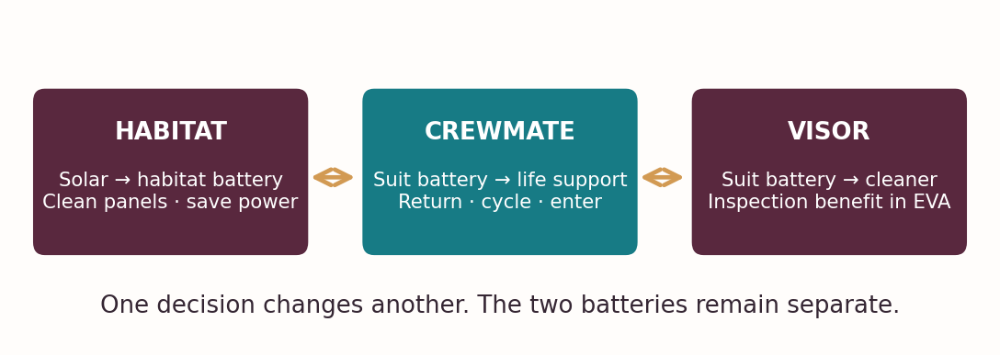
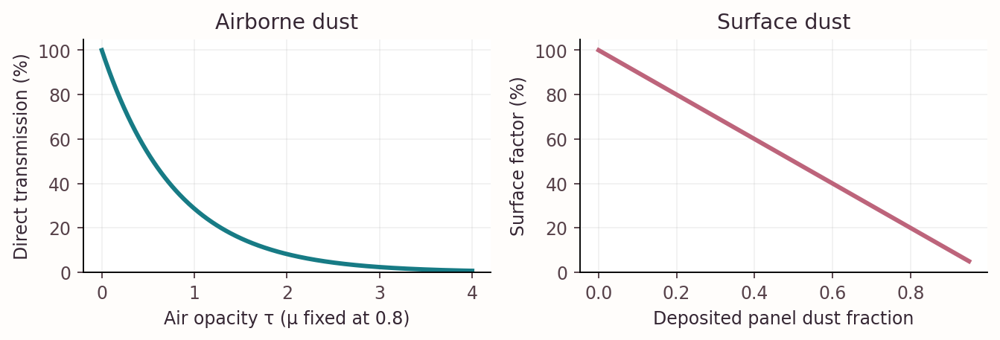
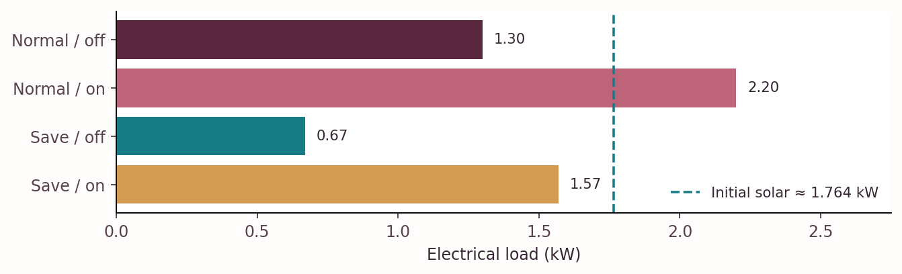
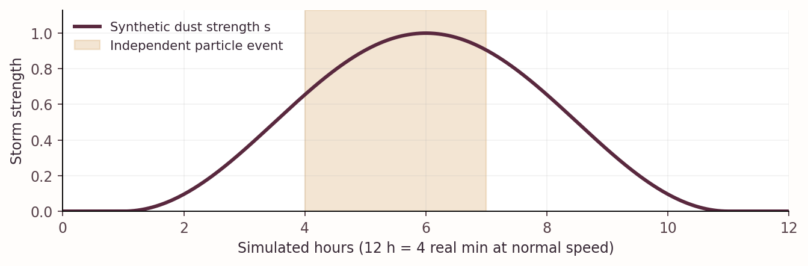

# KŌMAKU: Shield Protocol — The science inside the game

Readable companion to [the illustrated PDF](media/KOMAKU-Science-Guide.pdf). Build with `python3 scripts/build_science_guide.py`. This guide describes the indoor operator mission, optional EVA mode and native planner in the current source; it does not imply that every feature exists in an older download. Reviewed November 14, 2026. Equations describe the implemented teaching model, not certified spacecraft engineering.

## 01 · A small mission, a big idea

### For explorers, families and the team

**Your challenge:** protect a Mars outpost through dust and a separate particle event, without spending the energy needed to recover. The default player is a first-person operator inside the dome, helping the exposed crewmate Mira return. Optional EVA mode puts the player outside instead. The intended learners are ages 7–12, with adult help where useful.

The most important discovery is that “more protection switched on” is not always a better plan. Cleaning a panel costs energy. In optional EVA mode, a clearer visor helps inspection but uses the suit battery. In operator mode, the urgent decision is when to guide Mira home. A refuge reduces exposure because material is already there—not because it creates a magic force field.



### Read this at two levels

**Start simple:** read each page's opening idea and worked example. **Go deeper:** inspect the equations, units, source paths and limits. The glossary explains unfamiliar symbols. Every number is either a cited observation, a mathematical consequence, or an openly chosen game assumption.

**What this is:** one four-minute learning mission, deterministic comparison tools and small practice experiments. **What it is not:** NASA-endorsed training, a medical radiation guide, a full colony simulator, or evidence that children have already learned more from playing.

## 02 · The map and the units

### Follow the cause, not just the score

Atmospheric dust reduces incoming sunlight. Deposited dust reduces a panel's usable surface. Less generation changes habitat energy. In optional EVA mode, visor dust affects inspection speed, and inspection restores some modeled panel capacity. Operator mode leaves inspection at zero: modeled panels remain at the 0.75 inspection factor even when external equipment is hidden from view. Radiation accumulates independently; shelter changes its rate.

| Quantity             | Meaning                                     | Example                                                 |
| -------------------- | ------------------------------------------- | ------------------------------------------------------- |
| Power, W or kW       | How fast energy is transferred              | 1 kW = 1,000 W                                          |
| Energy, kWh          | Power accumulated over time                 | 2 kW for 0.5 h = 1 kWh                                  |
| Time, h or s         | Hours for resources; seconds for movement   | 1 h = 3,600 s                                           |
| Dose equivalent, mSv | Radiation quantity represented in this game | Rate × hours = accumulated mSv                          |
| Optical depth, τ     | Dimensionless measure of opacity            | Larger τ transmits less direct light                    |
| Fraction             | Part of a whole, usually 0–1                | Dust 0.28 means a model fraction, not measured coverage |
| g, m/s²              | Downward acceleration                       | The controller uses 3.71 m/s²                           |
| Δ                    | Change, or a small interval                 | Δt is one simulation step                               |

**Three useful operations:** `clamp(x, a, b)` keeps x between a and b. `exp(x)` means e raised to x. `max(0, x)` prevents a result going below zero. A “dimensionless” value has no physical unit.

**Predict first:** if an appliance uses 0.5 kW for 2 hours, how much energy does it use? **Answer: 1 kWh.** Power and energy are related, but they are not interchangeable labels.

## 03 · Which parts come from NASA?

### A measured starting point, not a measured whole mission

The bundled data record transcribes a published **0.67 mSv/day** average at **Gale Crater, August 2012–June 2013**, measured by Curiosity's Radiation Assessment Detector. NASA reports that this interval had no major solar storms affecting Mars [S1].

```text
Background rate = 0.67 / 24 = 0.0279167 mSv/hour
```

The mission uses that value as its background rate. It is a historical average, not a live forecast, a universal surface rate, or a prediction of an individual person's risk. The game does not ingest a raw instrument time series.

| Evidence                             | What it supports                           | What it does not supply                                                |
| ------------------------------------ | ------------------------------------------ | ---------------------------------------------------------------------- |
| Curiosity RAD summary [S1]           | Historical background dose-equivalent rate | This mission's particle-event timing or shielding factor               |
| Lunar dust-shield demonstration [S2] | Electric fields can remove surface dust    | Mars cleaning efficiency, power draw or suit certification             |
| NASA Mars facts [S3]                 | Thin atmosphere and environmental context  | The scripted storm curve                                               |
| Opportunity opacity near 11 [S4]     | A severe historical dust example           | The native mission's τ curve; used in the separate reference prototype |

NASA articles were retrieved successfully on November 14, 2026; source checks and excerpts are in `docs/evidence/challenge-source-check.json`. The official challenge and submission-guide pages returned HTTP 503. Current competition rules remain unverified; no award or eligibility promise follows from this guide.

**Trace:** `game/data/nasa-observations.json` → `mission.gd::_init()` → background rate in `environment()`.

## 04 · The numbers we deliberately chose

### These are teaching parameters, not hardware specifications

Unless marked as sourced, the values below are game assumptions. A balanced mission does not establish that the same equipment would work on Mars.

| Parameter                            | Value                       | Use                                        |
| ------------------------------------ | --------------------------- | ------------------------------------------ |
| Habitat capacity / starting energy   | 12 / 8 kWh                  | Battery ceiling / initial reserve          |
| Suit starting energy                 | 0.9 kWh                     | Separate store; no free indoor recharge    |
| Essential habitat load               | 0.55 kW                     | Always included                            |
| Optional load: normal / conserve     | 0.75 / 0.12 kW              | Conservation leaves essentials on          |
| Panel cleaner load                   | 0.90 kW                     | Added when enabled                         |
| Rated solar / inspection factor      | 4.8 kW / 0.75–1.00          | Before sky and surface losses              |
| Suit life support / visor cleaner    | 0.12 / 0.04 kW              | Charged only while outside refuge          |
| Panel / visor starting dust          | 0.28 / 0.25                 | Fractions capped at 0.95                   |
| Panel deposition / cleaning          | 0.035(0.3 + s) / 0.25 per h | s is synthetic storm strength              |
| Visor deposition / cleaning          | 0.03 + 0.12s / 0.60 per h   | Independent of panel dust                  |
| Inspection work constant             | 0.30 h                      | Progress is scaled by clear-visor fraction |
| Background / event dose rate         | 0.67/24 / 1.8 mSv/h         | Background sourced; added event synthetic  |
| Shelter multiplier / abort threshold | 0.15 / 4 mSv                | Illustrative; not a NASA safety limit      |
| Recovery energy / mission duration   | 2.4 kWh / 12 h              | Ending criteria / resource timeline        |
| Step / resource acceleration         | 1/120 h / 180×              | 30 simulated seconds per step              |

Initial time, inspection, dose, research and generation/consumption counters are zero. Cleaning, conservation, visor cleaning and shelter flags start false. Operator mode keeps inspection at zero; EVA can increase it. The fixed comparator uses a different declared starting policy (page 10).

**Trace:** `game/scripts/mission.gd`, constants, state fields, `environment()` and `step()`.

## 05 · Sunlight: dust in two different places

### Wiping a window cannot clean the whole sky

The model keeps **airborne dust** and **surface dust** separate. A cleaner removes deposited panel dust. It does not change atmospheric optical depth.

```text
Transmission T = exp(−τ / μ)
Solar power = 4.8 × (0.75 + 0.25I) × T × (1 − d) kW
Panel dust next = clamp(d + [0.035(0.3 + s) − 0.25c]Δt, 0, 0.95)
```

I is inspection completion (zero throughout operator mode), d is panel dust, s is storm strength, and c is 1 with the cleaner on or 0 with it off. μ is a synthetic sun-angle factor, not a full astronomical calculation.



**Example:** with τ = 0.25 and μ = 0.65, T ≈ 0.681. At initial inspection I = 0 and dust d = 0.28, solar power is approximately `4.8 × 0.75 × 0.681 × 0.72 = 1.764 kW`.

This is a Beer–Lambert-style direct-beam approximation. It omits diffuse skylight, wavelength effects, panel temperature/geometry, seasonal solar distance and conversion losses. The linear surface-dust factor is also illustrative. Real solar engineering needs those effects and measured panel data.

**Trace:** `mission.gd::environment()` and the panel-dust update in `step()`.

## 06 · The habitat battery, one step at a time

### Energy is the running balance

```text
Load = 0.55 + (0.12 if conserving else 0.75) + (0.90 if cleaning)
E next = clamp(E + [solar power − load]Δt, 0, 12) kWh
```

The cleaner's contribution is zero when off. The clamp means a full battery cannot hold more than its capacity and the stored value cannot become negative. This simplified battery has no charging losses, aging or temperature dependence. Excess potential charge is discarded by the ceiling.

**Worked first step:** start at E = 8 kWh, use the page 5 solar value ≈ 1.764 kW, normal work and cleaner off. Load = 0.55 + 0.75 = 1.30 kW. With Δt = 1/120 h, net energy ≈ `(1.764 − 1.30) / 120 = 0.00387 kWh`. New energy ≈ **8.00387 kWh**.



With the cleaner on, that first step costs an extra `0.90/120 = 0.0075 kWh`. Cleaner panels help later steps, because generation is calculated before dust is updated. Saving power reduces load by `0.75 − 0.12 = 0.63 kW`, but the optional-work counter runs at one quarter rate while the tracked subject is exposed. This counter is a model proxy, not an animation or simulation of Mira doing research during rescue.

**Think ahead:** a short-term energy cost can be worthwhile later. Compare both the length of the preview and its outcome. A bigger battery number after an early abort is not a better mission.

## 07 · Whose suit—and whose rescue?

### Two batteries mean two different responsibilities

In default operator mode, suit energy, visor dust and dose belong to Mira. The operator remains indoors; their position never shelters her. **Guide Mira** starts a continuous scripted return, followed by a timed airlock cycle and indoor entry. Only reaching the indoor receiver shelters her. The 20.30-metre approach and 1.60-metre entry use 60 metres per simulated hour, with a 0.15-hour cycle between them. Total continuous time is about 0.515 simulated hours (10.30 real seconds); fixed steps round protection to about 10.33 seconds. These are authored timings, not injury, pressure or rescue-engineering calculations. All phases pause with the mission.

Habitat conservation cannot refill the suit. While the tracked subject is exposed, automatic suit life support and enabled visor cleaning use its battery. Shelter preserves energy; it does not recharge.

```text
Suit E next = max(0, suit E − [0.12 + 0.04v]Δt)
Visor dust next = clamp(q + [0.03 + 0.12s − 0.60v]Δt, 0, 0.95)
Inspection next = min(1, I + [1 − updated visor dust]Δt / 0.30)
```

v is 1 when visor cleaning is on, otherwise 0; q is visor dust. Inspection progresses only in optional EVA mode while the player is exposed and actively inspecting. Operator mode keeps I = 0. The code uses the newly updated visor dust for that step.

**One exposed hour:** 0.9 kWh becomes 0.78 kWh with the visor cleaner off, or 0.74 kWh with it on, if the scenario continues throughout. These are model balances, not real EVA endurance.

**Optional EVA example:** constant clear-visor fraction 0.75 gives `0.30/0.75 = 0.40 simulated hours`, or 8 real seconds, to inspect. Actual dust, movement and aiming change that idealized timing.

EVA inspection can raise the array factor from 0.75 to 1.00. Mira’s operator-mode return adds no inspection progress. Cleaning the visor improves visibility; it does **not** block ionizing radiation.

**Trace:** `mission.gd::step()`, `companion_rescue.gd`, and mode-specific input/shelter orchestration in `game.gd`.

## 08 · Radiation: accumulate exposure, seek material

### Rate and time both matter

```text
Dose rate = [0.67/24 + (1.8 if event active else 0)] × f  mSv/h
Dose next = dose + dose rate × Δt
f = 0.15 when the tracked subject is sheltered, otherwise 1.00
```

The 1.8 mSv/h event addition and the 0.15 shelter factor are invented teaching values. Preinstalled material reduces the modeled rate. No continuously powered radiation shield is simulated. The storm and particle event have separate scripted causes.

**Worked example:** 30 simulated minutes during the event adds approximately `(0.0279167 + 1.8) × 0.5 = 0.914 mSv` outside, or `0.914 × 0.15 = 0.137 mSv` sheltered. That is the same elapsed time in the same fictional event. Shelter does not reduce already accumulated dose.

**The 4 mSv abort rule is fictional.** It is not a NASA exposure limit, a medical threshold, an injury prediction or advice for real radiation decisions. The game uses a gentle abort to teach planning. Real risk and protection require qualified analysis.

The game applies one factor to both background and event radiation. Real shielding depends on particle spectrum, material, thickness, geometry and secondary radiation; multiplying by a single number is not radiation transport. Suit fabric, embroidery and visor colour are not radiation calculations.

There is one integrated dose history: **Mira in operator mode, the player in optional EVA mode**. The indoor operator has no separate simulated dose. Mira remains exposed through return, airlock cycling and the final walk to the indoor receiver. In EVA, walking into the marked refuge changes shelter state. These two triggers must not be confused.

**Trace:** `mission.gd::environment()`, dose accumulation and terminal checks in `step()`.

## 09 · Two clocks and a scripted sky

### Fast resources, real-time movement

One real second advances resource time by 0.05 h = 180 simulated seconds. Thus 12 simulated hours take 240 real seconds. The model steps in intervals of 1/120 h = 30 simulated seconds; the controller accumulates elapsed time and takes fixed steps. Pausing stops the mission.

```text
s(t) = sin²[π × clamp((t − 1)/10, 0, 1)]
τ(t) = 0.25 + 2.8s(t)
μ(t) = 0.65 + 0.35sin(πt/12)
Particle event: 4 ≤ t < 7 simulated hours
```



These curves are authored scenario design, not observed weather. The native peak optical depth is 3.05, not the near-11 historical Opportunity value used by the separate reference prototype. The maximum storm strength is 1 at t = 6 h.

Movement uses Godot collision physics and a real-time Mars gravity approximation of 3.71 m/s². Indoor operator speed is 2.2 m/s; optional EVA speed is 5 m/s. The hop starts with 2.4 m/s vertical speed. Ignoring collision details, its ideal ballistic rise is `v²/(2g) ≈ 0.776 m` and return time `2v/g ≈ 1.294 s`. Those are controller choices, not validated suited-human locomotion.

The resource loop caps each rendered frame's contributed delta at 0.25 s to avoid huge catch-up after a stall. Movement, distances, task times and weather therefore do not share one coherent physical timescale. Authored operator bounds x = [−3, 3], z = [−16, −11.2] metres keep the player near the dome window. In optional EVA, the finite training area warns at 56 m radius and blocks outward movement at 62 m while allowing return and sideways movement; it is a navigation boundary, not a physical force field. Falling below −5 m recovers to spawn (operator z = −12.6 m). This is a teaching game, not a real-time mission simulator.

## 10 · AEGIS compares; the player decides

### Four counterfactuals, not a trained AI

In builds containing the native planner, press **P** or choose **Pause → Compare mission plans**. It pauses play and copies the current mission state into a private projection model. Each branch runs the actual `Mission.step()` equations for the same next simulated hour.

| Branch | Optional work setting | Panel cleaner |
| ------ | --------------------- | ------------- |
| 1      | Normal                | Off           |
| 2      | Normal                | On            |
| 3      | Conservation          | Off           |
| 4      | Conservation          | On            |

The tracked subject stays at the same shelter state, no additional inspection occurs and the visor setting stays unchanged. **It does not project Mira’s return, airlock cycle or indoor entry**, even after rescue has started. Read this as a fixed-state teaching comparison, not the complete expected rescue outcome. Every branch uses the scripted future. It stops at the preview horizon, an abort or mission end. The underlying API limits requests to at most two simulated hours; the normal interface requests one.

Compare only like durations. The summary compares cleaner settings at the same work setting, and conservation at the same cleaner setting, when both reach the horizon. It does not collapse energy, work and safety into one “best” score. **Use this plan** changes only the two habitat switches. It cannot trigger rescue, simulate the future return route or refill the suit. Guide Mira remains a separate operator action; in EVA, the player must move to shelter.

The debrief is a different comparison: its fixed baseline starts sheltered, with cleaning on and normal load, and skips inspection. It uses the same weather and abort rules but a different starting policy. Neither comparison proves universal superiority or real forecast accuracy.

**Algorithm:** copy → set two booleans → step until stopping condition → record energy, dose, suit, work, duration and status → repeat four times. No network request, learned parameters or live NASA forecast is involved.

**Trace:** `mission_adviser.gd`, `mission_planner.gd` and `game.gd::show_planner()`.

## 11 · Mira's local review algorithm

### A reminder to practise, not a grade

The academy has five concepts with authored questions, hints and explanations. Its provisional Bayesian knowledge-tracing estimate is an internal scheduling signal. It is neither a trained neural network nor a calibrated measurement of a child's ability. Winning or losing a mission chooses a support topic, not a mastery score.

```text
Initial p = 0.20; guess G = 0.25; slip S = 0.10; learn L = 0.12
After correct: q = p(1−S) / [p(1−S) + (1−p)G]
After incorrect: q = pS / [pS + (1−p)(1−G)]
Next estimate = clamp(q + (1−q)L, 0.01, 0.99)
```

**Example:** from p = 0.20, an independent correct response gives q = 0.18/(0.18 + 0.20) ≈ 0.474, then next ≈ 0.537. That is an algorithm state—not “53.7% mastered.” These hand-chosen probabilities need evaluation with the actual audience.

Hinted answers and repeats of the same question within 24 hours do not update the estimate. New concepts are offered first; afterward the earliest due concept is suggested. Reviews are due in 1 day after an incorrect answer or estimate below 0.55, 3 days below 0.80, otherwise 7 days. The device clock controls timing.

A bounded local JSON profile stores concept IDs, estimates, counts and timestamps. It contains no name or email and is not uploaded by the game. It has recovery/reset support but is not encrypted cloud sync. Shared-device users currently share the profile.

**Research:** knowledge tracing [S5] informs the update structure; spaced-repetition [S6] and retrieval-practice [S7] motivate evaluation. Their published findings do not establish efficacy for this game. Duolingo's fitted half-life model is not implemented.

**Trace:** `learning.gd` and `game/data/lessons.json`.

## 12 · Suit Lab: three tiny experiments

### Separate practice models, separate assumptions

The five Suit Lab experiments do not modify mission physics. Their feedback conditions are teaching targets, not medical or engineering acceptance limits. Cosmetic themes have no physical effect.

| Experiment      | Formula              | Worked example         |
| --------------- | -------------------- | ---------------------- |
| Radiation       | 1.8 × minutes/60 mSv | 30 min → 0.90 mSv      |
| Dust cleaning   | 100 × 0.6^passes %   | 3 passes → 21.6% left  |
| Thermal balance | heater watts − 60 W  | 80 W input → +20 W net |

**Radiation:** the slider is 0–60 minutes at one illustrative rate. Unlike the mission, this toy does not add historical background, change shelter state or integrate a time-varying event. Its “success” flag is minutes ≤ 10; that is not a safe-exposure recommendation.

**Dust:** each pass removes 40% of the remaining dust. After one pass 60% remains; after two, 36%; after three, 21.6%. It does not remove 40 percentage points every pass. The 0–5 input is bounded; feedback succeeds below 25%. This geometric rule is different from the mission's rate-based dust differential update.

**Thermal:** a fictional test plate loses a constant 60 W. The 0–120 W heater balances near 60 W, and feedback accepts net heat within ±5 W. The result is heat flow, not a calculated temperature. There is no heat capacity, radiative fourth-power law, convection or suit cooling loop here.

**Try it:** predict the dust after four passes before moving the slider. **Answer: 12.96%.** Then explain why each later pass removes less absolute dust.

**Trace:** `suit_experiments.gd::evaluate()`, cases 0–2.

## 13 · Suit Lab: supply and fit

### Ratios and trade-offs, not suit specifications

```text
Practice supply duration = 120 units / usage in units per minute
Mock fit score = 100 − 2 × abs(setting − 50)
```

**Life support:** use rate ranges from 1 to 6 practice oxygen units/minute. At 2 units/minute, the 120-unit supply lasts 60 minutes; at 4, it lasts 30 minutes. Feedback accepts at least 40 minutes. These are invented units and reserves: the game is not predicting oxygen-cylinder endurance, metabolism, CO₂ removal or a safe EVA.

**Pressure fit:** the input is a dimensionless setting from 0 to 100. Below 45 the lesson says loose; 45–55 is balanced; above 55 it says tight. At setting 50 the triangular score is 100, and at 25 it is 50. The displayed result is the qualitative state; this is not a pressure in pascals or a mechanical seal simulation.

| Laboratory idea          | Mission equivalent?                    | Keep the difference visible                                                     |
| ------------------------ | -------------------------------------- | ------------------------------------------------------------------------------- |
| Oxygen-duration division | No separate oxygen inventory           | The mission instead spends suit electrical energy                               |
| Mock seal balance        | No pressure solver                     | Doors/cycle are scripted; pressure, airflow and suit leakage physics are absent |
| Heater balance           | No thermal state                       | Habitat/suit thermal regulation is background context                           |
| Radiation and cleaning   | Related ideas, different toy equations | Never substitute lab feedback thresholds for mission parameters                 |

A good learning sequence is **predict → change one input → observe → explain → try a new case**. Two correct examples do not prove transfer or long-term understanding. Supervised playtests should check whether children can explain the difference between a demonstration model and real hardware.

**Trace:** `suit_experiments.gd::evaluate()`, cases 3–4; `suit_lab.gd` presents them.

## 14 · Under the hood: steps, safeguards and checks

### Reproducibility makes a claim inspectable

In each resource step, the code first calculates environment and power from the current state, then updates habitat energy and dose. While the tracked subject is exposed it updates suit energy, visor dust and the optional-work counter; held inspection is enabled only in EVA mode. Next it updates panel dust, energy counters and time, then checks ending rules. This is a fixed-step, explicit numerical update—not an exact continuous solution. In operator mode, each resource step accounts for Mira’s exposure first, then advances rescue. Completed shelter applies to subsequent resource steps; it never erases dose already accumulated.

Terminal checks run in this order: exhausted suit while exposed, exhausted habitat battery, dose at/above 4 mSv, then mission end. At the end, ≥2.4 kWh is success; less is partial recovery. Terminal states stop further resource integration. Reaching a checkpoint is not proof that every later game path works.

| Check family             | What it can establish                                                        | What it cannot establish                             |
| ------------------------ | ---------------------------------------------------------------------------- | ---------------------------------------------------- |
| Mission / gameplay tests | Arithmetic, input routes and declared ending behavior                        | Real equipment performance or learning outcomes      |
| Adviser tests            | Same-model projections, state isolation, bounded horizons and abort handling | Weather-prediction skill or globally optimal control |
| Learning tests           | Formula, scheduling and profile recovery behavior                            | A calibrated ability estimate                        |
| UI / platform checks     | Tested layouts and startup on specified machines                             | Every phone, graphics driver or accessibility need   |

Signed desktop content updates use a pinned public key plus manifest, size/hash and compatibility checks, followed by startup acknowledgment and recovery. The signature helps establish who authorized the content relative to the bundled key; hashes detect changed bytes. Neither makes the science true. Native engine changes still need a new installer; mobile self-updates are not implemented.

Rendering and decorative materials are separate from the mission state. Attractive glow, translucent glass or cloth-like geometry does not establish radiation shielding, pressure integrity, thermal behavior or fluid dynamics.

## 15 · What we leave out—and how to test next

### Honest boundaries are part of the design

**Not independently simulated:** food production, water recycling, habitat pressure, oxygen chemistry, CO₂ scrubbing, temperature control, material stress, suit leakage, dust particle dynamics, detailed radiation transport, separate simultaneous dose histories for both operator and crewmate, or realistic biomechanics. Baseline electrical loads stand in for many background functions.

**Not yet demonstrated:** reliable physical-device performance across the audience's hardware, expert-validated shielding/energy assumptions, full accessibility, or better comprehension, recall and engagement than an alternative lesson. The guide describes code behavior, not those outcomes.

### A simple experiment with the game

1. Write a prediction: “At this storm time, panel cleaning will cost more energy than it restores over the next hour.”
2. Pause and compare two planner branches that differ only in cleaning. Keep duration, work mode, starting state and weather the same.
3. Read duration and status first, then energy and dust. Do both branches reach the full preview? If not, explain the abort instead of ranking battery bars.
4. Repeat at another time or state. State what changed and what your evidence supports. The result applies to this model and chosen horizon.

### Better evidence, step by step

Ask a scientist or engineer to review units, assumptions and omitted processes. Import observational time series only with documented provenance, units, processing and uncertainty; keep synthetic gaps labeled. Measure real hardware frame time, memory and input usability. With appropriate adult supervision, test children's predictions, explanations, delayed recall and transfer—not just whether they finish the game.

No NASA endorsement, professional astronaut qualification, guaranteed hackathon result or validated educational benefit is claimed. No scientific question is settled by the use of a particular programming language or an attractive screenshot.

## 16 · Sources, code and reproduction

### Follow a statement back to its origin

[S1] NASA, _NASA Rover Results Include First Age Measurement on Mars and Help for Human Exploration_ (2013): [radiation source](https://www.nasa.gov/news-release/nasa-rover-results-include-first-age-measurement-on-mars-and-help-for-human-exploration/).

[S2] NASA, _NASA's Dust Shield Successfully Repels Lunar Regolith on Moon_ (2025): [lunar EDS demonstration](https://www.nasa.gov/image-article/nasas-dust-shield-successfully-repels-lunar-regolith-on-moon/).

[S3] NASA Science, _Mars Facts_: [planetary context](https://science.nasa.gov/mars/facts/). [S4] NASA, _Martian Dust Storm Grows Global_ (2018): [Opportunity opacity](https://www.nasa.gov/missions/martian-dust-storm-grows-global-curiosity-captures-photos-of-thickening-haze/). S1–S4 retrieved November 14, 2026 (HTTP 200); this guide uses the repository's recorded source excerpts, not raw instrument files.

[S5] Corbett & Anderson (1994), _Knowledge tracing: Modeling the acquisition of procedural knowledge_, UMUAI 4, 253–278: [DOI 10.1007/BF01099821](https://doi.org/10.1007/BF01099821). [S6] Settles & Meeder (2016), _A Trainable Spaced Repetition Model for Language Learning_: [ACL P16-1174](https://aclanthology.org/P16-1174/). [S7] Roediger & Karpicke (2006), _Test-enhanced learning_, Psychological Science 17(3), 249–255: [DOI 10.1111/j.1467-9280.2006.01693.x](https://doi.org/10.1111/j.1467-9280.2006.01693.x). On November 14, 2026, S5 and S6 resolved with HTTP 200 (S5 to a publisher cookie page); S7 returned HTTP 403, so full-text access was not verified. These sources inform design; their findings are not measured results for this game.

| Topic                             | Repository path                                                |
| --------------------------------- | -------------------------------------------------------------- |
| NASA records / numerical mission  | `game/data/nasa-observations.json` / `game/scripts/mission.gd` |
| Movement / rescue / resource loop | `game/scripts/player.gd` / `companion_rescue.gd` / `game.gd`   |
| Four-branch comparison / UI       | `game/scripts/mission_adviser.gd` / `mission_planner.gd`       |
| Academy / lab models              | `game/scripts/learning.gd` / `suit_experiments.gd`             |
| Detailed evidence and limits      | `docs/SCIENCE.md`, `LEARNING-DESIGN.md`, `VALIDATION.md`       |
| Rebuild this guide                | `python3 scripts/build_science_guide.py`                       |

The Markdown file is the readable source. The generator builds diagrams, embeds DejaVu fonts and records source fingerprints inside the PDF. Tested build versions: ReportLab 4.4.9, Matplotlib 3.10.8, Pillow 13.0.0 and PyMuPDF 1.26.6. `--check` needs only Python’s standard library. No project or learner data is sent to third-party services by the generator.

**Font notice:** this PDF embeds DejaVu font subsets. Open its **Attachments** panel for `DejaVu-Font-License.txt`, the complete copyright, trademark and permission notice. The same notice ships with the downloadable game.

made with love by Team Roshan Xingbo at the NASA Space App Hackathon 2026, NYC
