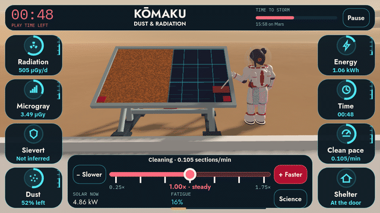

# Actual native cleaning motion



This silent clip shows approximately six seconds of the actual native game running its ordinary clock. Ren's hand and cleaning wand use the production animation, and the visible dust layer follows the mission model continuously. The clip starts from a documented fixture of 1.9 cleared sections and 16% game fatigue, after explicit Start, 18 active seconds at steady pace and 24 at the 1.25× setting. The real HUD slider selects 1× before recording, then changes to 1.75× after approximately two wall-clock seconds; both the hand animation and continuous model-driven clearing respond. The provenance records this ordinary control action and each frame’s actual pace, fatigue and clean fraction. It uses no camera changes, hand-joint assignments, time-lapse or invented frames. The ordinary 20× simulation clock compresses 30 mission minutes into 90 active play seconds; it is not accelerated separately for the clip. Recorded frame timing and actual model progress are retained even when software-renderer load reduces the frame rate.

The whole 960 × 540 viewport is scaled to 640 × 360 for this GIF, after a brief renderer warm-up. Playback retains the measured frame timing; a shared GIF palette changes image colour precision. This demonstrates native Linux animation, not performance on every device. See [`cleaning-live-provenance.json`](cleaning-live-provenance.json) for source hashes, frame hashes/timestamps, model start/end values and encoding details. Raw frame paths refer to the reproducible temporary capture directory, not bundled release assets.

Reproduce from the repository root:

```sh
python3 scripts/capture_cleaning_clip.py --output /tmp/komaku-cleaning-clip --publish-to docs/media/journey-0.9
```

Godot, Xvfb and Pillow are required. Use `--xvfb /path/to/Xvfb` when needed. Online requests are disabled in this capture fixture.
