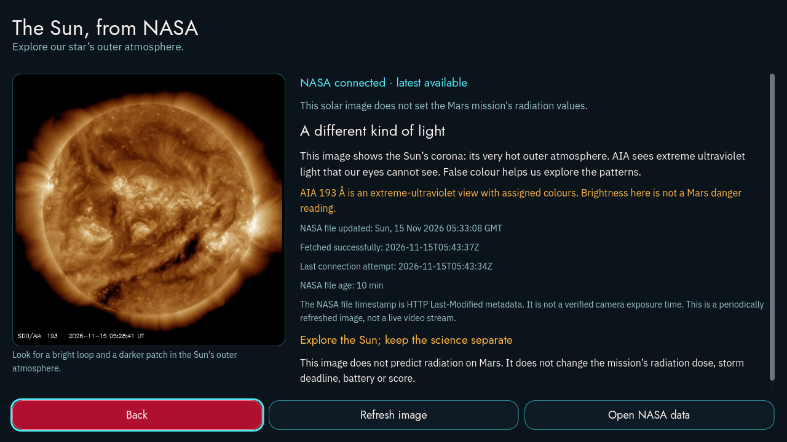

# Actual NASA SDO viewer capture



Courtesy of NASA/SDO and the AIA, EVE, and HMI science teams.

Captured **15 November 2026 at 05:43:37 UTC** after a verified HTTP 200 response. NASA reported the source file updated at **05:33:08 GMT**. This is dated evidence of a successful connection; later refresh attempts were unavailable. The viewer component is unchanged, and the provenance retains the exact source hashes from the capture rather than substituting newer build hashes.

This screenshot displays a validated HTTP 200 response from NASA's fixed [SDO AIA 193 Å browse-image endpoint](https://sdo.gsfc.nasa.gov/assets/img/latest/latest_512_0193.jpg), using the production native viewer. The whole source image remains visible, including its embedded timestamp. It is an extreme-ultraviolet, false-colour image of the solar corona. Its brightness is not a Mars radiation reading, storm prediction or medical risk score, and the viewer does not alter mission calculations.

[`live-sun-provenance.json`](live-sun-provenance.json) records the source-image SHA-256, received bytes, server file-update metadata, actual successful fetch time, TLS verification, viewport review and runtime source hashes. HTTP Last-Modified is file metadata, not independently verified camera exposure time. This capture demonstrates one successful NASA connection in the Linux native environment; service freshness, availability and other devices can differ.

Read [NASA's data context](https://sdo.gsfc.nasa.gov/data/) and [data-use rules](https://sdo.gsfc.nasa.gov/data/rules.php). The game also labels cached, old and bundled imagery explicitly.

To make a new real-network capture from the repository root:

```sh
python3 scripts/capture_live_solar.py --output /tmp/komaku-live-solar-capture --publish-to docs/media/journey
```

Add `--xvfb /path/to/Xvfb` when needed. The managed-network proxy adapter uses the configured certificate bundle and keeps TLS certificate verification enabled. No API key is used. General journey screenshots use a separate offline fixture so their capture does not trigger uncontrolled network requests.
