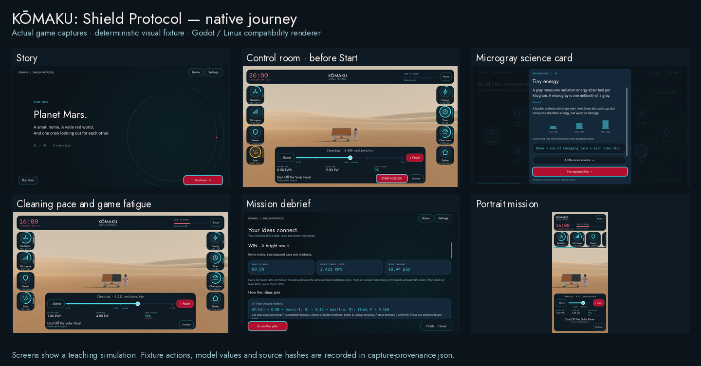

# Native journey screenshots

These are actual Godot screenshots of the stationary-cleaning journey in `game/main.tscn`. Ren starts cleaning only after START MISSION. The operator chooses a pace with slower/faster buttons or the stepped slider; faster work builds an authored game-fatigue indicator. At the countdown's end Ren steps directly inside. The visible panel clears dust continuously from the mission model.



| Screen                                                | Resolution |
| ----------------------------------------------------- | ---------- |
| [Story](story-desktop.png)                            | 1280 × 720 |
| [Control room · before Start](preflight-desktop.png)  | 1280 × 720 |
| [Microgray science card](concept-desktop.png)         | 1280 × 720 |
| [Cleaning pace and game fatigue](mission-desktop.png) | 1280 × 720 |
| [Mission debrief](debrief-desktop.png)                | 1280 × 720 |
| [Portrait mission](mission-portrait.png)              | 390 × 844  |
| [Optional science library](preparation-desktop.png)   | 1280 × 720 |

The capture fixture uses normal screen intents, then advances the actual model to repeatable points. The mission image follows explicit Start, 60 real-play seconds at steady cleaning plus 80 at 1.25×: 1.9 cleared sections and 16% game fatigue. The debrief follows 160 further active seconds at normal pace and automatic shelter entry: 3.58 cleared sections (WIN), with 10.9375 µGy accumulated model dose. There is no recall, walking mission or radio interaction in this final workflow. All values come from the model; no result summary is fabricated. The scene is illustrative and does not establish physical panel dimensions or human work-rate measurements. Battery energy stored now uses kWh; power generation and habitat load use kW. The rising radiation profile and game fatigue are authored teaching assumptions, not live NASA radiation data or personal health readings.

Captured with Godot's Linux compatibility renderer under authenticated Xvfb/Mesa. This checks native composition at desktop, portrait and short-landscape sizes. It does not establish Mac/Windows installation, mobile-device performance, audio quality, live update acceptance or real-time player usability. Audio output is muted only in the capture fixture, and user data is isolated.

`capture-provenance.json` records the source SHA-256 hashes, image hashes, actual model snapshots and fixture actions. The contact sheet contains only scaled native screenshots with external labels. The full QA run also captures preflight, steady/faster cleaning, live concepts, pause, settings, storm countdown, automatic entry, graphs and the learning-transfer question at 1280×720, 390×844 and 844×390.

Reproduce from the repository root (Godot, Xvfb and Pillow required):

```sh
python3 scripts/capture_journey.py --output /tmp/komaku-journey-capture --publish-to docs/media/journey
```

Use `--xvfb /path/to/Xvfb` if Xvfb is not on `PATH`. Publishing rejects any run with geometry findings or source changes during capture.
